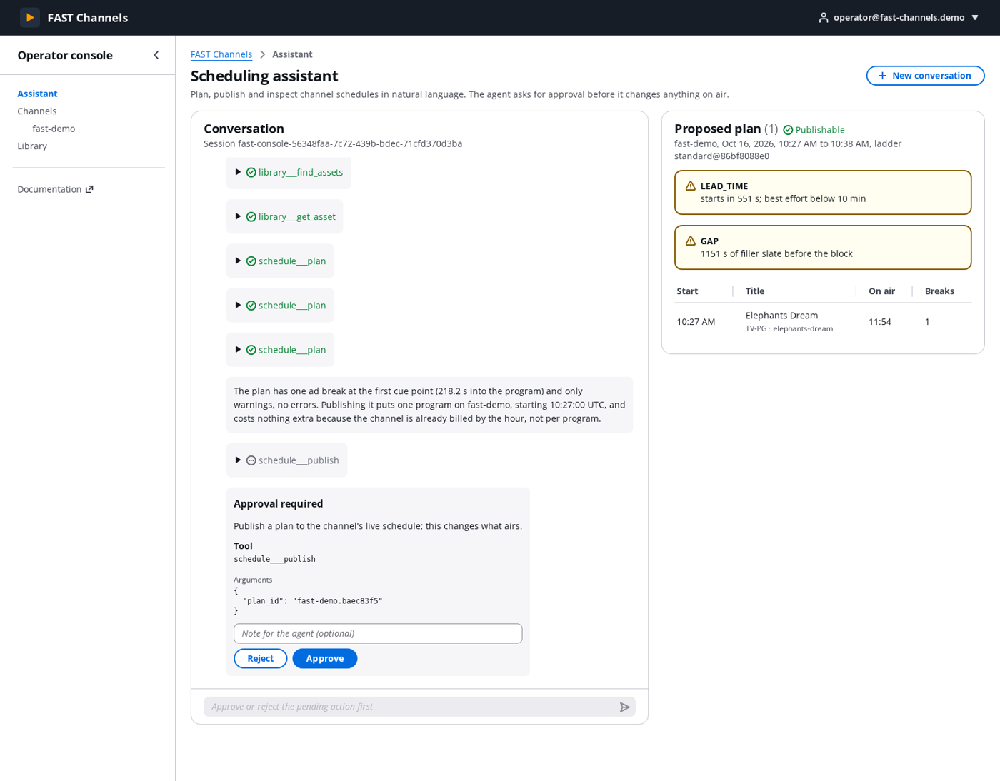
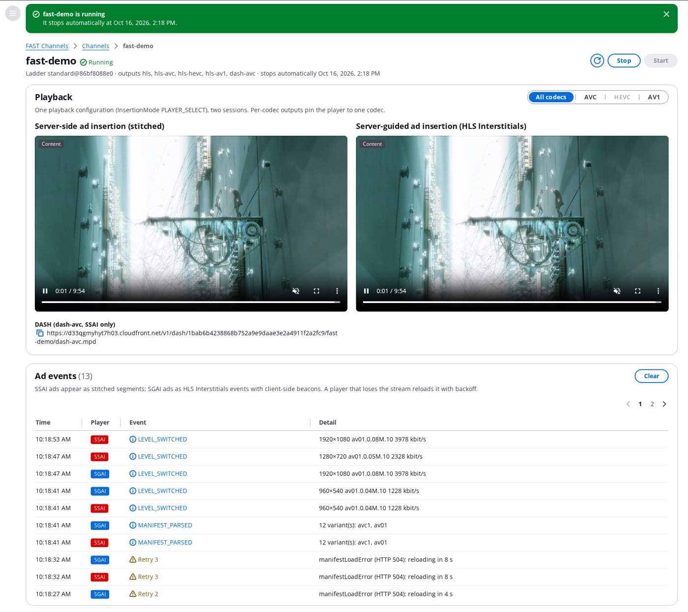

# FAST Channels on AWS

[](https://github.com/philhar88/AWS-Fast-Channels/actions/workflows/ci.yml)

FAST Channels on AWS is a reference architecture for free ad-supported streaming TV (FAST): linear channels assembled
from video-on-demand files, monetised with ad insertion and delivered through a CDN, with no live encoder. Mezzanines
are encoded once by AWS Elemental MediaConvert into one CMAF ladder of AV1, HEVC and AVC. AWS Elemental MediaTailor
Channel Assembly plays them as 24/7 schedules, MediaTailor inserts ads server-side (SSAI) or server-guided (SGAI), and
Amazon CloudFront delivers it all. Operators build and run the schedules by talking to a scheduling agent on Amazon
Bedrock AgentCore, whose tools do every calculation and whose actions are authorised by Cedar policies and approved by
a person. Everything deploys from one AWS CDK (Python) app.


## Key capabilities

- **Agentic scheduling on Amazon Bedrock AgentCore.** A Strands agent on AgentCore Runtime plans, validates and
  publishes schedules through 27 typed tools behind an AgentCore Gateway. Cedar policies authorise every call by the
  operator's Cognito group, approval-gated tools wait for a human, AgentCore Memory keeps conversations and operator
  preferences, and an optional autopilot keeps each channel 24 hours ahead. Claude Haiku 5.5 is the default model; any
  model that passes the included conformance suite can replace it. See [docs/agent.md](docs/agent.md).
- **One CMAF encode: AV1 + HEVC + AVC + AAC.** Validated, fingerprinted ladders (`standard` to 1080p by default,
  `uhd` to 2160p) compile to MediaConvert job templates. Each encode writes per-codec and per-resolution HLS and DASH
  manifests (*rendition profiles*) next to shared segments, and fixes what players and Channel Assembly need: AV1
  `av1C` levels, nominal `BANDWIDTH`, frame-exact GOPs. See [docs/encoding.md](docs/encoding.md).
- **Channel Assembly → MediaTailor SSAI and SGAI → CloudFront with OAC.** LINEAR channels read the private media bucket
  with SigV4; a channel policy admits only the channel's own playback configuration; one `PLAYER_SELECT` configuration
  serves stitched and HLS Interstitials sessions; CloudFront reaches S3 through origin access control and routes
  MediaTailor paths in a verified behaviour order that is also published as a CDN-neutral path contract. See
  [docs/channel-assembly.md](docs/channel-assembly.md) and [docs/delivery-and-multi-cdn.md](docs/delivery-and-multi-cdn.md).
- **Preconditioned ads.** House ads are encoded on each channel's own ladder and served from a static VAST 4.2 pod, so
  MediaTailor never transcodes them and every variant fills exactly, in SSAI and SGAI. Bring your own ad server with
  `ads.mode: external_vast`. See [docs/ad-insertion.md](docs/ad-insertion.md).
- **Traceability.** Every service logs to CloudWatch with retention; one correlation id threads an upload through Step
  Functions, MediaConvert, Channel Assembly, the ad decision request and the CDN logs. `make trace ID=<id>` prints the
  timeline; a dashboard, alarms and saved queries come with the deployment. See
  [docs/observability.md](docs/observability.md).
- **Safe to run and to delete.** Channels never start on deploy and stop themselves after four hours; a reaper removes
  everything created at runtime before CloudFormation deletes the stacks; cdk-nag checks every synth.

## The operator console

Operators work with the agent in a Cognito-protected console. The agent plans in tools, shows the plan and asks
before anything changes on air; the channel view plays the same channel through SSAI and SGAI side by side (here
AV1 1080p in Chromium), with ad and interstitial events and the program guide.





## Prerequisites

- An AWS account and credentials that can create the resources (administrator access is simplest for a first
  deployment), in a Region with MediaTailor Channel Assembly, MediaConvert and Amazon Bedrock AgentCore, for example
  `us-east-1`, `us-west-2` or `eu-west-1`. Synthesis validates the Region, and the agent's default models resolve to
  its Bedrock inference profiles (`us.`, `eu.`, `au.` or `global.`), so no Region needs model overrides.
- The account and Region [bootstrapped for the AWS CDK](https://docs.aws.amazon.com/cdk/v2/guide/bootstrapping.html):
  `npx cdk bootstrap aws://<account>/<region>`. Outside us-east-1, bootstrap us-east-1 too (CloudFront logs are
  delivered from there).
- [Node.js 24](https://nodejs.org) (the CDK CLI version is pinned in `package.json`; the console is built with it).
- [uv](https://docs.astral.sh/uv/), which installs Python 3.14 and every dependency from `uv.lock`.
- The [AWS CLI v2](https://docs.aws.amazon.com/cli/latest/userguide/getting-started-install.html) for the commands below.
- Docker is optional: Lambda code is bundled locally with uv and falls back to a container only when uv is missing.
- Access to the agent's Amazon Bedrock models (Anthropic Claude). `make model-access` checks it and explains what is
  missing; new accounts submit Anthropic's one-time use-case form.

## Quick start

1. **Install and check model access.**

   ```bash
   git clone https://github.com/philhar88/AWS-Fast-Channels.git && cd AWS-Fast-Channels
   make install
   make model-access
   ```

2. **Deploy.** Takes about 20 minutes, unattended (measured: 20 min 20 s; Data 2:48, Media 11:18 including the
   default ladder's kit, Operator 5:29). It builds the console, synthesises with cdk-nag and deploys
   `FastChannels-Data`, `FastChannels-Media` and `FastChannels-Operator`, including the `standard` ladder's slate and
   house-ad kit and a stopped demo channel, `fast-demo`.

   ```bash
   make deploy
   ```

3. **Create an operator user.** Or set `agent.admin_email` in `cdk.json` before deploying and Cognito emails you an
   invitation.

   ```bash
   POOL=$(aws cloudformation describe-stacks --stack-name FastChannels-Operator \
     --query "Stacks[0].Outputs[?OutputKey=='UserPoolId'].OutputValue" --output text)
   aws cognito-idp admin-create-user --user-pool-id "$POOL" --username you@example.com \
     --user-attributes Name=email,Value=you@example.com Name=email_verified,Value=true
   aws cognito-idp admin-add-user-to-group --user-pool-id "$POOL" --username you@example.com --group-name fast-admins
   ```

4. **Open the console** at the `ConsoleUrl` output and sign in with the temporary password from the invitation email.

   ```bash
   aws cloudformation describe-stacks --stack-name FastChannels-Operator \
     --query "Stacks[0].Outputs[?OutputKey=='ConsoleUrl'].OutputValue" --output text
   ```

5. **Load sample content.** `make seed` loads four open-licensed titles (about 39 minutes of video) into the
   reference catalog and the media library. It first shows the encode estimate (about $22) and asks you to confirm.
   The Blender Foundation's servers refuse MediaConvert's own HTTPS fetcher, so the script streams each file (about
   1.6 GB in all) through your machine into the ingest bucket as `samples/<content id>.<ext>`, after a JSON sidecar
   with its catalog id, cue points and correlation id. That upload starts the ingest, exactly as a CMS dropping files
   into the bucket would ([integrate-your-cms.md](docs/integrate-your-cms.md#ingest-contract)). It prints a line
   after each upload, so a large title can take minutes with no output on a slow connection, and it returns once the
   uploads are done, while encoding goes on. MediaConvert encodes the titles in parallel with accelerated
   transcoding (measured: Elephants Dream, 10:54, in 3 min 47 s; Tears of Steel, 12:14, in 5 min 19 s), so expect
   every title to be READY about 10 to 15 minutes after the uploads. Follow the encodes in the console's Library
   view, or pass `--wait`.

   ```bash
   make seed                              # or: make seed SEED_ARGS="--wait"
   ```

6. **Ask the agent for a schedule.** In the console's Assistant, for example: *"Fill fast-demo from the next full
   hour for two hours with the sample titles, with ad breaks about every 12 minutes."* The agent shows the plan with
   every start time, break and rule check, then asks for approval before publishing it.

7. **Start the channel.** Every program airs at its planned time; a channel started after a program's start skips
   the programs it missed (the agent lists them, and the guide marks them `SKIPPED`) and airs the rest on time. Ask
   *"Start fast-demo"* (and approve), or use **Start** in the Channels view. A BASIC channel costs $0.10 per running
   hour and stops automatically after four hours. The Channels view plays an SSAI and an SGAI session side by side,
   with the ad and beacon events of each.

`make deploy PREFIX=<name>` deploys an independent copy (`FastChannels-<name>-*`); see
[docs/operations.md](docs/operations.md) for configuration and day-two operations.

## Cost

us-east-1 list prices; see [docs/operations.md](docs/operations.md#costs) for every line item.

| Item | Price |
|---|---|
| Encoding with the `standard` ladder (AV1 + HEVC + AVC to 1080p) | about $0.56 per content minute |
| Encoding with the `uhd` ladder (to 2160p) | about $1.36 per content minute |
| Ladder kit (slates and house ads), once per ladder version | about $3.56 (`standard`), $8.63 (`uhd`) |
| Channel Assembly, per running channel-hour | $0.10 BASIC, $0.35 STANDARD |
| MediaTailor ad insertion | $0.25 (VOD rate) or $0.50 (live rate) per 1,000 ads |
| AgentCore Runtime | $0.0895 per vCPU-hour and $0.00945 per GB-hour, only while a session is active |
| AgentCore Gateway, Policy, Memory | $0.005 per 1,000 tool calls; $0.025 per 1,000 authorisations; Memory by usage |
| Bedrock tokens, Claude Haiku 5.5 | about $0.003–0.006 per schedule built |
| CloudFront, S3, CloudWatch | Standard rates for delivery, storage and logs |

Channels are never started by a deployment, and a started channel stops after `channels.max_runtime_hours` (4 by
default). With stopped channels an idle deployment costs a few dollars a month (alarms, storage, logs).

## Repository layout

```
├── core/        fast_channels.core       pure domain library: ladders, rendition profiles, MediaConvert settings,
│                                         timelines, manifests, MediaTailor request shapes, VAST, cost
├── functions/   fast_channels.functions  Lambda handlers: ingest steps, agent tools and registry, custom resources,
│                                         autopilot
├── agent/       fast_channels.agent      AgentCore Runtime app: Strands agent, AG-UI, hooks, skills, evals
├── infra/       fast_channels.infra      CDK app: configuration, constructs, stacks, stage
├── console/                              operator console (Vite, React, TypeScript, Cloudscape, hls.js)
├── contracts/                            catalog OpenAPI, IngestRequest and event JSON schemas (generated)
├── ladders/                              built-in ladder TOML files (symlink to core package data)
├── assets/                               brand stills for slates and house ads, sample catalog
├── docs/                                 documentation, ADRs, architecture image, CDN path contract
├── scripts/                              model access, seeding, tracing, cleanup, model evals, generators
├── tests/e2e/                            end-to-end tests against a deployed stage (release gate)
├── cdk.json                              CDK app and the fast-channels configuration
└── Makefile                              make help
```

## Using parts of it in your own CDK app

The constructs are ordinary CDK constructs with documented props (see the
[construct catalogue](docs/architecture.md#construct-catalogue)). Constructs that bundle Lambda code build it from
this repository's uv workspace, so write your app inside a clone or fork and run it through the workspace:

```python
# my_app.py
import os
from pathlib import Path

from aws_cdk import App, Environment, Stack
from aws_cdk import aws_mediaconvert as mediaconvert
from constructs import Construct

from fast_channels.core.ladder import Ladder
from fast_channels.infra.config import FastChannelsConfig
from fast_channels.infra.constructs.encoding import EncodingLadder
from fast_channels.infra.stage import FastChannelsStage, stage_id


class Transcoding(Stack):
    """MediaConvert job templates for an existing pipeline, compiled from a FAST Channels ladder."""

    def __init__(self, scope: Construct, id: str, **kwargs) -> None:
        super().__init__(scope, id, **kwargs)
        queue = mediaconvert.CfnQueue(self, "Queue", pricing_plan="ON_DEMAND")
        ladder = Ladder.load(Path("ladders/standard.toml"))  # or your own TOML
        EncodingLadder(self, "Standard", ladder=ladder, prefix="myapp", queue_arn=queue.attr_arn)


env = Environment(account=os.environ.get("CDK_DEFAULT_ACCOUNT"), region=os.environ["CDK_DEFAULT_REGION"])
app = App()
Transcoding(app, "Transcoding", env=env)

# A whole deployment with its configuration in code instead of cdk.json.
config = FastChannelsConfig.model_validate(
    {"prefix": "news", "channels": {"iac": [{"name": "news-24", "outputs": ["hls", "hls-avc"]}]}},
    context={"region": env.region},
)
FastChannelsStage(app, stage_id(config.prefix), config=config, env=env)
app.synth()
```

```bash
# '**' selects every stack of the app: Transcoding and the stage's FastChannels-news/*
npx cdk deploy --app "uv run --frozen --package fast-channels-infra python my_app.py" '**'
```

Run the CDK CLI from the repository root so that `cdk.json`'s feature flags apply. `fast_channels.core` has no AWS
dependencies and can be used on its own, for example to validate ladders or compile job settings in another pipeline.

## Cleanup

```bash
make destroy                       # make destroy PREFIX=<name> for other deployments
```

The runtime-resource reaper deletes agent channels, programs, VOD sources, runtime source locations and job templates
before CloudFormation deletes the stacks. With `removal: retain` data is kept and stacks are termination protected.
If a teardown is interrupted, `uv run python scripts/cleanup.py` lists the runtime resources that are left and
`--apply` deletes them; then run `make destroy` again. The account-level
`FastChannels-AccountBaseline` stack (only with Transaction Search enabled) and the account-shared as-run log group
are never deleted automatically. Details in [docs/operations.md](docs/operations.md#destroy).

## Documentation

| Document | Contents |
|---|---|
| [Architecture](docs/architecture.md) | Planes, stacks and outputs, ownership rule, ingest, scheduling and playback flows, construct catalogue, data model |
| [Encoding](docs/encoding.md) | Ladder model, built-in ladders, rendition profiles, frame rates, cue points, kits, cost, custom ladders |
| [Channel Assembly](docs/channel-assembly.md) | SigV4 origin, source groups, channels and tiers, slates, programs, EPG, quotas, bring-your-own content |
| [Ad insertion](docs/ad-insertion.md) | SSAI and SGAI, playback configuration, preconditioned ads, external VAST, ADS variables, beaconing |
| [Delivery and multi-CDN](docs/delivery-and-multi-cdn.md) | CloudFront behaviours, OAC, path contract, content domain, multi-CDN, capacity |
| [The scheduling agent](docs/agent.md) | AgentCore usage, tool reference, Cedar, approvals, autopilot, AG-UI, models, memory |
| [Integrate your CMS](docs/integrate-your-cms.md) | Catalog contract, OpenAPI Gateway target, ingest contract, events |
| [Observability](docs/observability.md) | Logging and tracing matrix, correlation contract, trace script, alarms, Transaction Search |
| [Operations](docs/operations.md) | Configuration reference, deploy and destroy, users, quotas, costs, security, troubleshooting |
| [Migrating from v2](docs/migration-from-v2.md) | What changed and how to move from the SAM-based v2 |
| [Decision records](docs/adr/README.md) | Why the architecture is the way it is |
| [Console](console/README.md), [Agent](agent/README.md) | Component READMEs |

## Development

`make check` runs what CI runs: formatting, linting, strict type checks, unit and infrastructure tests, the console
build and `cdk synth` with cdk-nag. The end-to-end suite runs against a deployed stage and is the release gate:

```bash
uv run pytest tests/e2e -m e2e --prefix <prefix>
```

See [CONTRIBUTING.md](CONTRIBUTING.md) for the setup, branch model and conventions.

## Versioning and support

Releases follow [semantic versioning](https://semver.org) and are tagged `vX.Y.Z`; see [CHANGELOG.md](CHANGELOG.md).
v3 is a rewrite on the AWS CDK and is maintained on `main`. The SAM-based releases remain available, unmaintained:
v2 on `release/2.x` (tag `v2.0.0`) and v1 on `release/1.x` (tag `v1.0.0`). To move from v2, follow
[docs/migration-from-v2.md](docs/migration-from-v2.md).

Questions and bugs: [GitHub issues](https://github.com/philhar88/AWS-Fast-Channels/issues). Security issues: see
[SECURITY.md](SECURITY.md). Contributions: see [CONTRIBUTING.md](CONTRIBUTING.md).

This is sample code for building your own solution. It deploys billable AWS resources into your account, and you are
responsible for the content you stream, your rights to it, and the cost of what you run.

## License and sample content

MIT License; see [LICENSE](LICENSE). Sample content (`make seed`) is copied from its publishers' servers into your
ingest bucket and not redistributed here: *Sintel* and *Tears of Steel* (CC BY 3.0, © Blender Foundation) and
*Elephants Dream* (CC BY 2.5, © Orange Open Movie Project). Credit them when you broadcast them; see [NOTICE](NOTICE).
