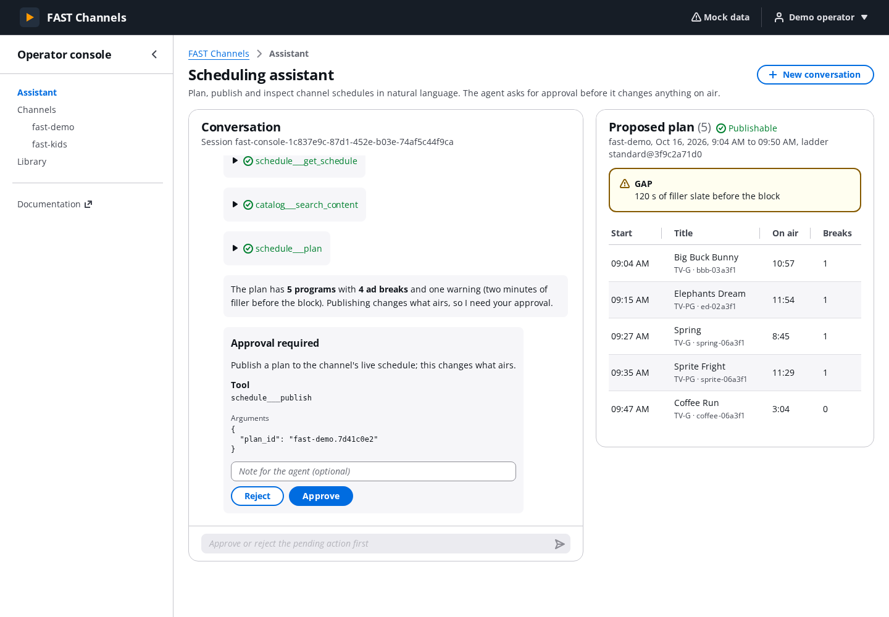
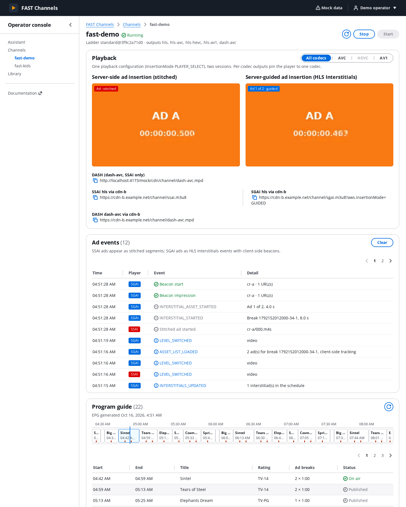
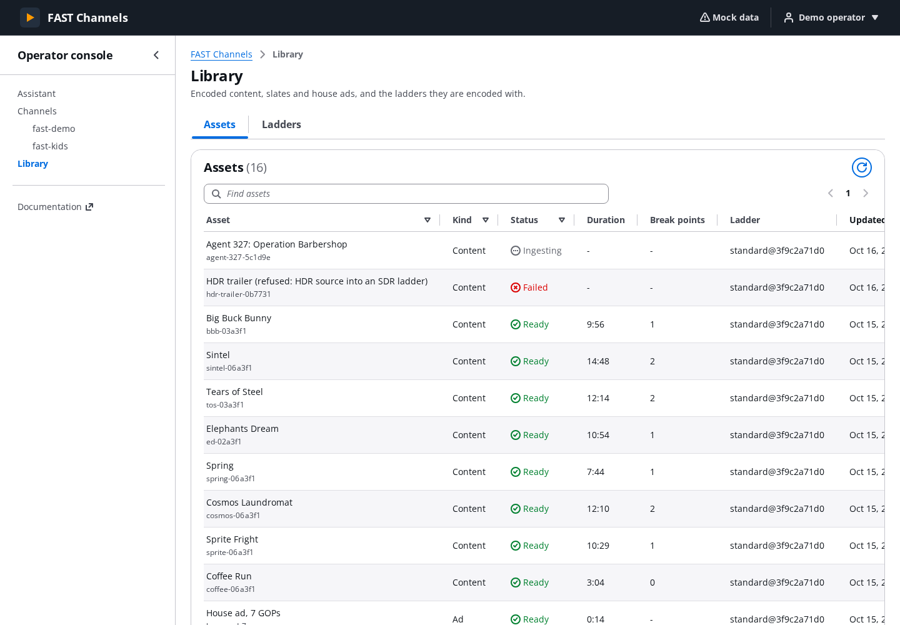

# FAST Channels operator console

A single-page app for running the channels that FAST Channels on AWS deploys. It has three views:

| View | What it does | Backend |
|---|---|---|
| **Assistant** | Streaming chat with the scheduling agent. Shows tool activity, approval cards for actions that change what airs, and the plan or schedule the agent is working on. | AgentCore Runtime, AG-UI over SSE |
| **Channels** | Plays an SSAI (stitched) session and an SGAI (HLS Interstitials) session of the same output side by side while the channel runs, and an off-air screen while it is stopped. Adds a codec selector, DASH links, a log of ad, interstitial, beacon and reload events, the EPG timeline, and Start/Stop. | Media CDN, AgentCore Gateway (`channels___*`), EPG feed |
| **Library** | Lists assets (content, slates, house ads) and encoding ladders with their kits. | AgentCore Gateway (`library___find_assets`, `encoding___list_ladders`) |





Built with Vite 8, React 19, TypeScript (strict), the [Cloudscape](https://cloudscape.design) design system with its
chat components, `react-oidc-context`/`oidc-client-ts` (Cognito managed login, Authorization Code + PKCE) and hls.js 1.7.3.

## Quick start (mock mode, no AWS account needed)

```bash
cd console
npm ci
npm run dev:mock          # http://localhost:5173 ; or `npm run dev` and open http://localhost:5173/?mock
```

Mock mode (`VITE_MOCK=1` or `?mock` on any build) replaces Cognito, the Runtime, the Gateway and the EPG feed with
in-browser fixtures (`src/mock/`):

- a scripted agent that emits the same AG-UI events as the real one: tool calls, Markdown tables, `STATE_SNAPSHOT`
  plans and schedules, `approval_required` interrupts (two at once for "stop fast-demo and fast-kids"), and the
  resumed runs, with a `DECLINED` result for a rejected call;
- a Gateway that keeps channel state in memory. Starting a stopped channel skips the program it would join midway,
  as the real tool does. fast-demo's guide shows programs skipped by a start 20 minutes earlier;
- local HLS media under `mock/cdn`. These are tiny video-only CMAF clips, regenerated by `npm run mock:media`
  (requires ffmpeg). The SSAI stream has stitched ads behind discontinuities. The SGAI stream has a slate plus an
  `EXT-X-DATERANGE` interstitial whose asset list carries client-side `TRACKING` beacons.

The Vite dev and preview servers serve `mock/cdn` at `/mock/cdn`. It is never part of `dist/`.

## Against a deployed stack

```bash
curl -s https://<console-domain>/config.json -o public/config.json   # git-ignored
npm run dev                                                          # http://localhost:5173
```

The console Cognito client lists `http://localhost:5173/` as a callback and logout URL, so sign-in works locally.
The Runtime and the Gateway answer CORS for any origin (verified, see below). The media CDN's response-headers
policy sends `Access-Control-Allow-Origin: *` (SPEC §5.4).

## Scripts

| Script | Purpose |
|---|---|
| `npm run dev` / `dev:mock` | Vite dev server (backend from `public/config.json`, or fixtures) |
| `npm run typecheck` | `tsc -b` (app + tooling configs, `noEmit`) |
| `npm run lint` | ESLint flat config (typescript-eslint strict + stylistic type-checked, React hooks/compiler rules), zero warnings |
| `npm test` | Vitest unit tests of the protocol, transcript, Gateway, schedule, beacon, player retry and gating, and routing modules |
| `npm run build` | Type-check, then build to `dist/` |
| `npm run preview` | Serve `dist/` with the production Content-Security-Policy |
| `npm run test:e2e` | Playwright smoke tests: the production bundle in mock mode under the strict CSP; fails on any CSP violation (`npx playwright install chromium` once) |
| `npm run screenshots` | Same tests, refreshing `docs/screenshots/*.png` |

## Deploying

CI or the Makefile runs `npm ci && npm run build`. The `OperatorConsole` construct uploads `console/dist` to its
private bucket behind CloudFront with OAC. A BucketDeployment writes `config.json` next to `index.html` and
invalidates both. The build does not depend on the environment: everything deployment-specific comes from
`config.json` (CONTRACTS §H), fetched with `cache: "no-store"` at startup.

Caching: `index.html` and `config.json` should be `no-cache`. `assets/*` is content-hashed and can be immutable.
Routes are hash routes (`#/channels/<name>`), so CloudFront needs no SPA error-page fallback, and the OIDC redirect
(`/?code=…`) never collides with a route.

### Required Content-Security-Policy

The bundle has no inline script or style: React and Cloudscape set styles through the CSSOM. `npm run preview` and
`npm run test:e2e` enforce this policy. Because hosts vary by deployment, they widen `connect-src` to
`https://*.amazonaws.com https://*.amazoncognito.com`. The `data:` and `blob:` sources are there because the tests
failed without them:

```
default-src 'self'; script-src 'self'; style-src 'self'; img-src 'self' data:;
font-src 'self' data:;                                  # Cloudscape global-styles embeds Open Sans as data: WOFF2
media-src 'self' blob: data:;                           # MSE blob: URLs; hls.js text tracks use src="data:,WEBVTT"
worker-src 'self' blob:;                                # hls.js transmuxer worker
connect-src 'self' https://<media CDN domain>
            https://*.mediatailor.<region>.amazonaws.com   # SGAI asset lists (interstitials.mediatailor…), beacon domain
            https://bedrock-agentcore.<region>.amazonaws.com
            https://*.gateway.bedrock-agentcore.<region>.amazonaws.com
            https://cognito-idp.<region>.amazonaws.com https://<prefix>.auth.<region>.amazoncognito.com;
frame-ancestors 'none'; base-uri 'self'; form-action 'self'; object-src 'none'
```

SGAI asset lists are the one request that bypasses the CDN: MediaTailor writes absolute
`interstitials.mediatailor.<region>` URLs. With `ads.mode = external_vast`, third-party beacon hosts must also be
added to `connect-src`.

## How it talks to the backend

**Agent (`src/lib/agui.ts`, `src/lib/useAgentChat.ts`).**
- The browser POSTs an AG-UI `RunAgentInput` straight to `runtimeInvokeUrl`. It sends the user's Cognito **access**
  token as `Authorization: Bearer` (the Runtime rejects ID tokens) and
  `X-Amzn-Bedrock-AgentCore-Runtime-Session-Id` = `threadId` = `fast-console-<uuid>` (at least 33 characters, one
  per conversation).
- The agent keeps the conversation in AgentCore Memory, so a prompt run carries only the new user message. An
  approval resume carries no message and `forwardedProps.approval = {interrupt_id, approved, note}` on the same thread.
- One run at a time per conversation: the input and the approval buttons are disabled while a run streams, because
  aborting a stream stops only the browser and a second run would race the first on the agent's session. A resume
  answers one approval; the agent then asks again for the others under the same `interrupt_id`, which updates the
  card already shown.
- Every run starts with a token that has at least 10 minutes left (`src/lib/tokens.ts`): the agent forwards it to the
  Gateway, which checks its expiry on every tool call of the run. Silent renewal runs at the same margin, and
  concurrent callers share one refresh.
- `state` echoes the last `STATE_SNAPSHOT`. Its `schedule_scope` says whether `schedule` is the channel's guide from
  now on (`channel`) or only the programs this conversation published (`published`), and the panel is labelled to
  match.
- AG-UI tool results have no status. A call is failed when its content is an `{"ok": false}` envelope, and declined
  when the envelope's code is `DECLINED`; the agent wraps Cedar denials and Gateway errors in an envelope too.
- Agent replies are rendered with `react-markdown` and `remark-gfm` (tables), without raw HTML; links open in a new tab.
- The SSE stream is parsed by a small WHATWG-conformant reader (`src/lib/sse.ts`). `@ag-ui/client` would work
  (HttpAgent accepts custom headers), but it adds about 470 KB minified (rxjs, zod, protobuf) to parse one stream.
- Rendered events: `RUN_*`, `TEXT_MESSAGE_START/CONTENT/END`, `TOOL_CALL_START/ARGS/END/RESULT`, `STATE_SNAPSHOT`,
  and `CUSTOM` `approval_required`. Any other event type is ignored.

**Gateway (`src/lib/gateway.ts`, `src/lib/tools.ts`).**
- Start/Stop and the Library call MCP `tools/call` on `gatewayUrl` with the user's access token. Every call adds
  `correlation_id: console-<uuid>`.
- Start and stop are CONFIRM tools. The console's confirmation dialog is the approval, and Cedar still authorises by
  Cognito group.
- Output contract: `src/lib/tool-schemas.json` holds the wire schema (`ok: true` plus the output model, `null`s
  dropped) of every tool the console reads, including the schedule tools behind `STATE_SNAPSHOT`. It is generated by
  `uv run pytest functions/tests/test_console_contract.py` (which rewrites a stale file and fails). In
  `src/lib/tool-schemas.test.ts`, `tsc` checks that the types in `tools.ts`/`schedule.ts` declare only fields the
  tools return, and vitest checks the mock fixtures against the schemas.
- Verified against a live gateway (CUSTOM_JWT inbound, Lambda target, 2026-10-16):
  - the preflight answers `access-control-allow-origin: *`, echoes `authorization,content-type` (and the MCP
    headers), allows `POST`, with max-age 172800;
  - `tools/call` works without `initialize` and returns no `Mcp-Session-Id`. Responses are `application/json`, and
    401s carry CORS headers.
- Error mapping:

  | Gateway response | `ToolCallError` code |
  |---|---|
  | Tool output `{"ok": false, "error": …}` | the tool's own code |
  | `isError: true` with "ValidationException …" | `VALIDATION` |
  | JSON-RPC -32602 | `VALIDATION` |
  | JSON-RPC -32001 | `UNAUTHENTICATED` |
  | "Tool Execution Denied" | `FORBIDDEN` |

**Players (`src/players/`).**
- One hls.js instance per session, and only while the channel can serve a stream (`gate.ts`). The page reads the
  channel's state (`channels___get_channel`) every 15 s. While it is STOPPED or MISSING, an off-air screen stands
  in for each player and no session is opened. The players mount when the state turns RUNNING, whether after
  Start here or a start by the agent, with no page reload, and unmount when the channel stops. If the Gateway cannot
  report a state, the players try the stream anyway.
- A stopped or starting channel answers the manifest with 504 through the CDN (`failed to generate manifest: Unable
  to obtain template playlist`, observed on the deployed stage). A missing one answers 404. hls.js retries a few
  times itself (`manifestLoadPolicy`, `playlistLoadPolicy`), then raises a fatal network error and stops for good.
  `retry.ts` then opens a new session after 2, 4, 8 and 16 s, and every 30 s after that. Each reload is logged
  in the event log (`Retry n`, with the hls.js error and HTTP status). The backoff starts over once a session
  buffers media. Fatal media errors are logged and not retried. Interstitial asset-list and asset errors are never
  fatal: hls.js falls back to the primary content.
- SSAI ads are detected by their segment path below the CDN root (`/v1/segment/`, `/tm/`, `/ads/`,
  `/preconditioned-ads/`).
- SGAI uses hls.js HLS Interstitials (`INTERSTITIAL_*`, `ASSET_LIST_LOADED`). The console appends
  `aws.reportingMode=CLIENT` to the SGAI URL. Preconditioned SGAI ads have no server-side beacon hooks, so
  `beacons.ts` fires each asset's `TRACKING` beacons itself:
  - impression and start when the asset starts;
  - quartiles as the asset playhead passes them;
  - complete when the asset ends.

  It expands `[CACHEBUSTING]`/`[TIMESTAMP]` and sends with `fetch(no-cors)`.
- The output selector switches between per-codec HLS outputs (`hls`, `hls-avc`, `hls-hevc`, `hls-av1`). It disables
  any output whose codec `MediaSource.isTypeSupported` rejects. DASH outputs are listed as copyable links: SSAI only,
  since MediaTailor has no DASH SGAI.

**EPG.** `<epgBaseUrl>/<channel>.json` (CONTRACTS §I), refreshed every minute and whenever the channel starts or
stops. A missing feed (403/404 from S3) means "nothing published yet".
- `SKIPPED` programs never aired: a stopped channel was started after their planned start, so
  `channels___start_channel` removed them instead of letting them push the rest of the schedule late. The Start
  notice lists them. The guide shows them hatched in the timeline and as *Skipped* in the table, and lists them for
  half an hour after their planned end.
- *On air* marks the program scheduled now only while the channel runs, and never a skipped one, since filler plays
  in its slot.

### hls.js patch

`vite.config.ts` (`hlsSubtitleFixes`) edits `hls.js/dist/hls.mjs` as Vite bundles or serves it, in two places. They
fix two subtitle bugs that stopped captions on a live channel, still present in the hls.js canary in October 2026
([captions.md](../docs/captions.md#through-channel-assembly-ad-insertion-and-players)):

- `onSubtitleFragProcessed` returned on a failed fragment, which then stayed loaded but never buffered, so subtitle
  loading stalled for the session. SSAI's blank WebVTT ad segments in IMSC1 renditions fail at every break. The fix
  counts a failed fragment as buffered.
- `_parseIMSC1` parsed a fragment before the main stream had the initial PTS of its discontinuity
  (`initPTS.baseTime` of undefined). The fix queues it as `_parseVTTs` does for WebVTT.

Each edit must match exactly once, so another hls.js version fails the build until they are reviewed; drop them
once hls.js ships equivalent fixes. A plugin rather than patch-package keeps the console free of new dependencies
(patch-package's dependency tree carried a high-severity npm advisory in October 2026). `optimizeDeps.exclude` makes
the dev server serve hls.js through the plugin too.

### Known player caveat

hls.js 1.7.3 starts an append-in-place interstitial only once the buffered A/V range reaches within 10 ms of the
`DATERANGE` start (`interstitials-controller.ts`). Otherwise it stalls at the boundary and never loads the asset
list.
- AAC frames (1024 samples) can leave the audio buffer about 20–30 ms short of a segment boundary. Muxed test clips
  with audio reproduced the stall, so the mock media is video-only.
- Channel Assembly breaks are video-segment aligned with separate audio renditions. Verify SGAI playback on a live
  channel before demos.

## Source layout

```
src/
  main.tsx, App.tsx            bootstrap (config → Cognito → backend), shell (TopNavigation, SideNavigation, AppLayout)
  lib/                         config, session, backend, router, sse, agui, transcript, useAgentChat, gateway, tools,
                               schedule (Plan/EPG types + feed), useAsync, useInterval, notifications, errors, format
  components/                  CognitoSession, AwsBackend, NotificationsProvider, ChannelActions, EventLog,
                               OffAirScreen, ProgramGuide, EpgTimeline, ProgramTable, AgentStatePanel, JsonBlock
  players/                     HlsPlayer, gate (state gating), retry (backoff), telemetry (SSAI/SGAI event log),
                               beacons (client-side tracking), codecs
  views/                       AssistantView, ChannelsView, LibraryView
  mock/                        fixtures, scripted agent, mock gateway, MockProviders
mock/cdn/                      mock HLS media (scripts/mock-media.sh)
e2e/                           Playwright smoke tests
```

TypeScript is pinned to 6.0: typescript-eslint 8 supports `typescript <6.1`, and the native TypeScript 7 compiler
has no JavaScript API for it yet.
