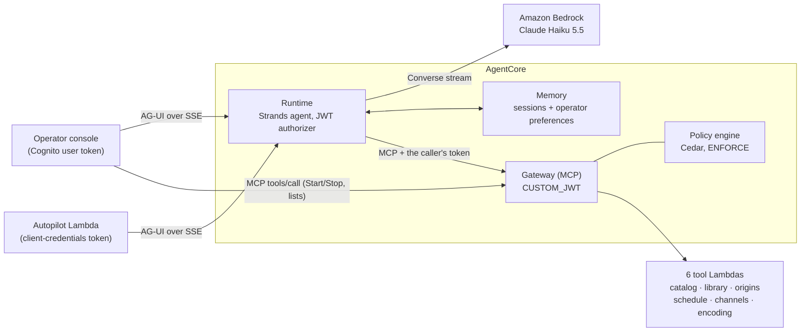

# The scheduling agent

Operators run their channels by talking to a scheduling agent: *"Fill fast-demo from 18:00 to midnight with family
titles, breaks every 12 minutes."* The agent is a [Strands](https://strandsagents.com) agent on Amazon Bedrock
AgentCore Runtime. It acts only through typed tools behind an AgentCore Gateway, every call is authorised by Cedar
policies as the *operator* (not the agent), and every call that changes what airs or costs money waits for human
approval.

- [Components](#components)
- [How a run works](#how-a-run-works)
- [Tool reference](#tool-reference)
- [Authorisation: Cognito groups and Cedar](#authorisation-cognito-groups-and-cedar)
- [Approvals](#approvals)
- [Autopilot](#autopilot)
- [AG-UI protocol](#ag-ui-protocol)
- [Models](#models)
- [Memory](#memory)
- [Observability and evaluations](#observability-and-evaluations)

## Components



| AgentCore capability | How FAST Channels uses it |
|---|---|
| **Runtime** | Code-zip deployment (`PYTHON_3_14`, arm64) of `fast_channels.agent`, `ProtocolType: AGUI`, Cognito JWT authorizer for the console and autopilot clients, the `Authorization` header forwarded to the code, sessions idle out after 10 minutes and end after 2 hours |
| **Gateway** | One MCP endpoint with one Lambda target per tool target; schemas generated from the tool registry; inbound `CUSTOM_JWT` (Cognito, scope `fast-channels/agent.invoke`); semantic tool search off |
| **Policy** | A Cedar policy engine in `ENFORCE` mode attached to the Gateway, policies generated from the registry |
| **Memory** | Short-term events (30 days) for stateless sessions and pending approvals, plus a `USER_PREFERENCE` long-term strategy per operator |
| **Identity** | Inbound: Cognito access tokens on Runtime and Gateway. Outbound: the agent forwards the operator's own token to the Gateway, so no service credential exists. AgentCore Identity credential providers are the extension point for API-key targets ([integrate-your-cms.md](integrate-your-cms.md#option-b-your-cms-api-as-an-openapi-gateway-target)) |
| **Observability** | ADOT (`opentelemetry-instrument`) in the Runtime, with message content off unless `observability.capture_prompts`; vended application logs of Runtime, Gateway and Memory; traces when CloudWatch Transaction Search is on |
| **Evaluations** | Online evaluation of 10 % of sessions (goal success, tool selection, tool parameters) when traces are on; an offline model conformance suite in the repository |

Not used in v3.0: the managed Harness (slower to first event and no hooks for approvals or UI state;
[ADR-0011](adr/0011-runtime-over-harness.md)), agent-to-agent (A2A; the Gateway's MCP endpoint is the integration
surface for other agents), Browser and Code Interpreter.

## How a run works

1. The Runtime validates the Cognito access token and passes the AG-UI `RunAgentInput` and the `Authorization`
   header to `POST /invocations`.
2. The caller's identity comes from the token, never from the payload: `actor_id` is `sub`, or `client_id` for the
   autopilot's machine token.
3. The agent opens an MCP connection to the Gateway **with the caller's token** and lists the tools Cedar allows for
   that principal (cached for 5 minutes per principal; an empty list is asked for once more and never cached, and a
   second empty list ends the run with `GATEWAY_UNAVAILABLE`). Only `<target>___<tool>` tools reach the model, and
   `correlation_id` is hidden from their schemas.
4. The Strands agent is rebuilt for every run from the AgentCore Memory session (history, loaded skills, pending
   approvals), so the process holds no conversation state. It gets the system prompt
   (`agent/src/fast_channels/agent/prompts/system.md`), four domain skills (`scheduling`, `channel-assembly`,
   `ad-insertion`, `encoding-ladders` under `agent/src/fast_channels/agent/skills/`) and two hooks:
   - `ToolGuard` sets `correlation_id` to the session id on every Gateway call and raises an approval interrupt for
     every approval-gated tool;
   - `SharedStateTracker` turns `schedule___plan`, `schedule___get_schedule`, `schedule___publish` and
     `schedule___remove_programs` results into AG-UI shared state, which the console renders as tables: publishes
     and removals are folded into the guide the run already read.
5. Standard AG-UI events stream back over Server-Sent Events.

The prompt's central rule is the architecture's: **tools do the arithmetic and the validation; the model only
chooses**. Start times, on-air durations, break offsets, SCTE-35 ids and costs always come from a tool.

## Tool reference

Generated from the tool registry (`fast_channels.functions.tools.registry`), which also generates the Gateway schemas,
the Cedar policies and the approval list. "Groups" are the Cognito groups Cedar permits; "Autopilot" is whether the
autopilot's machine token may call the tool.

| Tool | Access | Approval | Groups | Autopilot | Description |
|---|---|---|---|---|---|
| `catalog___search_content` | read | none | viewers, operators, admins | yes | Find titles to schedule. Filters combine with AND; genres and ratings match any listed value. Results are paged with next_token. |
| `catalog___get_content` | read | none | viewers, operators, admins | yes | Full metadata of one title, including cue points, rights window and assets. |
| `library___find_assets` | read | none | viewers, operators, admins | yes | List library assets matching every given filter (kind, status, ladder_version, content_id), one compact row each, paged with next_token. Use it to find READY content encoded with a channel's ladder version before planning, or to see what is still ingesting; library___get_asset has the full asset. |
| `library___get_asset` | read | none | viewers, operators, admins | yes | Get one asset in full: its valid ad-break offsets (ms), VOD source, package paths, the other ladder versions it is encoded with, and the ingest error if it FAILED. |
| `library___ingest` | write | confirm | operators, admins | no | Encode a mezzanine file into the media library with a ladder version (MediaConvert, billed per output minute). Encode with the ladder of the channel that will air it; pass the catalog duration_ms to get estimated_cost_usd. Cue points between segment boundaries make ad breaks frame-accurate with ESAM, at the Professional tier (about 1.6 times the Basic cost). Returns as soon as the ingest pipeline starts; poll library___get_ingest_status with the execution_name until done (minutes). Refuses assets already in the library unless they FAILED, and S3 sources outside the ingest bucket. |
| `library___get_ingest_status` | read | none | viewers, operators, admins | yes | Check an ingest: the pipeline run (status, error) and the library asset it produces (status, VOD source, duration, number of break offsets); done is true once the run has finished. Pass the execution_name from library___ingest, or the asset_id. |
| `origins___list_source_locations` | read | none | viewers, operators, admins | yes | List the Channel Assembly source locations of the account: this deployment's, those the agent created for operators' own buckets, and any others, with their bucket and segment delivery URL. |
| `origins___create_source_location` | write | confirm | operators, admins | no | Create a SigV4 Channel Assembly source location for an operator's S3 bucket holding pre-encoded content. Returns the bucket-policy statements the operator must apply before origins___register_vod_source can read the bucket; show them verbatim (the agent never edits bucket policies). Idempotent for the same name and bucket. |
| `origins___register_vod_source` | write | none | operators, admins | no | Register pre-encoded HLS content from a source location as a schedulable library asset (owner agent). Every manifest must match the ladder exactly (video codec, resolution, frame rate and muxed audio codec of every variant, in order; LADDER_MISMATCH otherwise) because Channel Assembly switches programs variant by variant. Duration and ad-break offsets are computed from the media playlists; the asset is READY at once. |
| `origins___update_package_configurations` | write | confirm | operators, admins | no | Replace the source groups (rendition profiles) an asset's VOD source serves. Channel Assembly needs every program, slate and filler of a channel to serve every output of the channel, so add a group before a channel with that output airs the asset. Pass the complete new set. |
| `origins___list_alerts` | read | none | viewers, operators, admins | yes | List Channel Assembly alerts of a channel (and its programs), a VOD source or a source location, most severe first. Check a channel after every schedule change and before starting it: SCHEDULING_ERROR alerts break playback. The expected SEGMENT_DURATION_MISMATCH and BANDWIDTH_MISMATCH warnings are left out (counted in suppressed) unless include_noise is set. |
| `schedule___get_schedule` | read | none | viewers, operators, admins | yes | Get a channel's published schedule from now on: programs with UTC start/end, title, rating, ad breaks and status (SKIPPED: removed unaired because the channel started late), the end of the schedule (end; schedule___plan appends there by default) and the filler gaps between programs. |
| `schedule___plan` | write | none | operators, admins | yes | Plan a block of programs on a channel; nothing changes on air. The picks air back to back in the given order from start, right after the program named in after, or by default where the published schedule ends (10 minutes from now when it is empty). Computes every start time, on-air duration (content plus ad breaks), ad break and SCTE-35 id, and checks the brief (ratings, genres, dayparts) and the schedule (overlaps, lead time). Returns a plan_id with the program table in UTC, the violations and publishable. Error violations block publishing: change the picks or the start and plan again; warnings are for the operator to accept. Publish with schedule___publish within the hour. |
| `schedule___publish` | write | confirm | operators, admins | yes | Publish a plan to the channel's live schedule; this changes what airs. Takes only the plan_id of a publishable plan from schedule___plan (plans expire after an hour). Fails with PLAN_STALE when the schedule changed since planning: call schedule___get_schedule and plan again. Returns the published programs as guide entries and the channel's alerts. |
| `schedule___remove_programs` | write | confirm | operators, admins | no | Remove programs that have not started yet from a channel's live schedule and guide. Every other program keeps its planned start, so filler slate airs in their place. Programs that are on air or over are reported in not_found. |
| `schedule___get_brief` | read | none | viewers, operators, admins | yes | Get a channel's programming brief: allowed ratings and genres, dayparts (UTC) and the ad-break policy that every plan is checked against. Read it before picking content. |
| `schedule___update_brief` | write | confirm | operators, admins | no | Replace a channel's programming brief, the standing rules every future plan is checked against. Pass the complete brief: start from schedule___get_brief and change only what the operator asked for. |
| `channels___list_channels` | read | none | viewers, operators, admins | yes | List the deployment's channels: live state (RUNNING is billed by the hour), owner, tier, ladder version and outputs. channels___get_channel adds the playback URLs and the auto-stop time. |
| `channels___get_channel` | read | none | viewers, operators, admins | yes | Get one channel: live state, owner, tier, ladder version, outputs, the viewer playback URL per output (SSAI; per CDN when several are configured) and the pending auto-stop time. Give operators these URLs verbatim; never build playback URLs yourself. |
| `channels___start_channel` | write | confirm | operators, admins | no | Start a channel so viewers can watch it. It is billed per hour while running (BASIC ~$0.10/h, STANDARD ~$0.35/h) and is stopped automatically after the deployment's maximum runtime (auto_stop_at); starting a running channel only moves the auto-stop. A stopped channel first drops the programs whose planned start has passed, which would otherwise air late: they are returned in skipped (SKIPPED in the guide) with a hint to relay to the operator, and every later program airs at its planned time. Returns the channel's alerts: SCHEDULING_ERROR alerts break playback. |
| `channels___stop_channel` | write | confirm | operators, admins | no | Stop a channel: playback ends for every viewer and billing stops. Published programs stay in the schedule and the guide. When the channel is started again, the programs whose start has passed by then are skipped and the rest air at their planned times. |
| `channels___create_channel` | write | confirm | operators, admins | no | Create an agent-owned linear channel &lt;prefix&gt;-agent-&lt;name&gt; with its ad-insertion playback configuration (SSAI), logs and channel policy. The ladder version must be READY (encoding___list_ladders), and the channel airs only assets encoded with it. The channel is created STOPPED and costs nothing until channels___start_channel; fill it with schedule___plan and schedule___publish. Fails with QUOTA at the deployment's agent-channel limit and CONFLICT when the name is taken. |
| `channels___delete_channel` | destructive | confirm | admins | no | Delete an agent-owned channel (&lt;prefix&gt;-agent-*): stop it, then remove its programs, guide, playback configuration and log deliveries. Cannot be undone. Channels defined by the deployment (owner iac) cannot be deleted; stop them instead. |
| `encoding___list_ladders` | read | none | viewers, operators, admins | yes | List encoding ladder versions with status, top resolution, rendition count, encode cost per content-minute and kit (filler and break slates, house ads). Channels need a READY version; ingest also accepts a PROVISIONING one. |
| `encoding___get_ladder` | read | none | viewers, operators, admins | yes | Get one ladder version in full: every rendition (names for propose_ladder's drop_rungs), audio, frame rate, GOP/segment grid, options, manifest profiles, kit and provisioning status or error. |
| `encoding___propose_ladder` | read | none | viewers, operators, admins | yes | Propose a new ladder version derived from a base version: cap or floor the height, shift quality, drop rungs. Changes nothing. Returns a proposal_id (valid 24 hours), the diff, validation errors and warnings, the encode cost per content-minute and the kit cost. Show it all to the operator; only a valid proposal they accept goes to encoding___provision_ladder. |
| `encoding___provision_ladder` | write | confirm | operators, admins | no | Provision a proposed ladder version: create its MediaConvert job template and encode its kit (filler slate, break slates, house ads and ad pod) with it. Costs the kit encode (kit_cost_usd of the proposal) and takes minutes: poll encoding___get_ladder until READY. Only then can channels___create_channel use the version, and content must be ingested with it (library___ingest) to air on such a channel. Nothing is started when the version is already PROVISIONING or READY. |

27 tools: 14 read, 12 write, 1 destructive; 11 need approval. To regenerate the table after changing the registry:

```bash
uv run python - <<'EOF'
from fast_channels.functions.tools.registry import Access, all_tools
from fast_channels.infra.constructs.operator.cedar import AUTOPILOT_TOOLS, GROUPS_BY_ACCESS
for s in all_tools():
    groups = ", ".join(g.value.removeprefix("fast-") for g in GROUPS_BY_ACCESS[s.access])
    autopilot = "yes" if s.access is Access.READ or s.qualified_name in AUTOPILOT_TOOLS else "no"
    description = s.description.split(chr(10) * 2)[0].replace(chr(10), " ").replace("<", "&lt;").replace(">", "&gt;")
    print(f"| `{s.qualified_name}` | {s.access} | {s.approval} | {groups} | {autopilot} | {description} |")
EOF
```

### Results and errors

Every tool returns a JSON object. Success is `{"ok": true, …}`; failure is an envelope the agent can reason about:

```json
{"ok": false, "error": {"code": "PLAN_STALE", "message": "…", "retryable": false, "hint": "Plan again."}}
```

Codes: `VALIDATION` (the arguments only), `NOT_FOUND`, `CONFLICT`, `THROTTLED`, `PLAN_STALE`, `LADDER_MISMATCH`,
`QUOTA`, `FORBIDDEN`, `UPSTREAM`, `INTERNAL`. AWS errors are mapped (`ConflictException` → retryable `CONFLICT`,
`TooManyRequestsException` → retryable `THROTTLED`, …); timeouts and transport errors are retryable `UPSTREAM`;
`INTERNAL` is a fault inside the tool (for example a stored item that no longer validates), which changing the
arguments cannot fix. A tool call never fails without an envelope. The agent retries only retryable errors, at most
twice.

A publish that stops part-way keeps the underlying error's code and says how far it got (`published 2 of 5 programs
of fast-demo.1a2b3c4d, then: …`). The programs published so far are in the library and the guide; publishing the
same `plan_id` again adds the rest, which is also what its hint says. Calls that change something leave a
`tool audit` log record ([observability.md](observability.md#audit-trail)).

Every tool accepts an optional `correlation_id`; the Runtime sets it to the session id and every log line of the
call carries it ([observability.md](observability.md#correlation-contract)). Each target is one Lambda function
(`fast_channels.functions.tools.<target>.handler`) that dispatches on the Gateway's
`bedrockAgentCoreToolName` client context; the Operator stack's `ToolFunctions` output names them.

## Authorisation: Cognito groups and Cedar

Operators are Cognito users (administrator-created only) in one of three groups:

| Group | May call | Through Cedar |
|---|---|---|
| `fast-viewers` | Read tools (14) | `permit_read` |
| `fast-operators` | Read and write tools (26) | `permit_read`, `permit_write` |
| `fast-admins` | Everything (27) | adds `permit_destructive` |
| Machine client (with an `autopilot_cron`, or `agent.machine_client`) | Read tools, plus `schedule___plan` and `schedule___publish` on the channels that have an autopilot schedule (none without one) | `permit_autopilot`, `permit_autopilot_plan`, `permit_autopilot_publish`, `forbid_autopilot_confirm` |
| A user in no group | Nothing | |

The Gateway authorises every `tools/list` and `tools/call` against the policy engine, so the agent sees only the tools
its caller may use, whatever the model tries. Policies are generated by
`fast_channels.infra.constructs.operator.cedar.gateway_policies` and deployed as `<engine>_<policy>`, for example
`fast_tools_permit_read` (AgentCore policy names are unique per account, not per engine); a denial names the policy.
JWT claims are principal tags, and an array claim such as `cognito:groups` arrives as JSON text, so group membership
is a `like` match:

```cedar
permit(
  principal is AgentCore::OAuthUser,
  action in [
    AgentCore::Action::"channels___delete_channel"
  ],
  resource == AgentCore::Gateway::"arn:aws:bedrock-agentcore:us-east-1:111122223333:gateway/fast-tools-abc123"
)
when { principal.hasTag("cognito:groups") && (principal.getTag("cognito:groups") like "*\"fast-admins\"*") };

forbid(
  principal,
  action in [
    AgentCore::Action::"channels___delete_channel"
  ],
  resource == AgentCore::Gateway::"arn:aws:bedrock-agentcore:us-east-1:111122223333:gateway/fast-tools-abc123"
)
unless { context.input has channel && context.input.channel like "fast-agent-*" };
```

Forbids always win: `forbid_iac_channels` keeps every caller, admins included, from deleting channels CloudFormation
owns, and `forbid_autopilot_confirm` keeps the autopilot away from every approval-gated tool except publishing. The
autopilot's plan and publish permits name its channels (`context.input.channel`, and the `<channel>.` prefix of a
`plan_id`), so it cannot touch other channels' schedules. The
engine runs in `ENFORCE` mode. No role in the solution may update the Gateway, its targets, the policy engine or its
policies: the Runtime, tool and autopilot roles carry an explicit `Deny` on those actions, because whoever holds them
could switch enforcement to `LOG_ONLY`. IAM below Cedar is least privilege too: destructive MediaTailor actions are
granted only on `<prefix>-agent-*` names, and creation calls only with this deployment's `fast:app` request tag
([ADR-0009](adr/0009-jwt-gateway-with-cedar-groups.md)).

To bring your own identity provider, point the Runtime and Gateway authorizers at its OIDC discovery URL and emit an
array group claim that the policies match (adapt `GROUPS_CLAIM` in `cedar.py` if it is not `cognito:groups`).

## Approvals

The 11 approval-gated tools are those marked `confirm` above (passed to the Runtime as `CONFIRM_TOOLS`). When the
model calls one:

1. `ToolGuard` raises a Strands interrupt. The run emits a `CUSTOM` event `approval_required` with
   `{interrupt_id, tool, arguments, reason, tool_call_id}` and ends with `RUN_FINISHED` whose `outcome.type` is
   `interrupt`. The pending approval is stored with the session.
2. The console shows an approval card with the exact arguments and the cost the agent quoted from the tool.
3. The client resumes the same thread with `forwardedProps.approval = {"interrupt_id", "approved", "note"}` (or the
   standard AG-UI `resume` list). Approved: the very tool call that was shown runs. Declined: it is cancelled, its
   `TOOL_CALL_RESULT` is a `DECLINED` error envelope, and the model reads the note. A new message while an approval
   is pending declines it, with the message as the note.

Several approval-gated calls in one turn (*"stop fast-demo and fast-news"*) raise one interrupt each. A resume answers
the approvals it carries; the agent asks again, with the same `interrupt_id`, for any it left open, and the console
updates that card instead of adding another. The console keeps Approve, Reject and the prompt box disabled while a
run streams, so one session never has two runs at a time. Unknown or replayed interrupt ids return `RUN_ERROR`
`APPROVAL_NOT_FOUND`. The console's own Start and Stop buttons call the Gateway directly with the user's token behind
a confirmation dialog; the click is the approval, and Cedar still decides.

## Autopilot

Give an IaC channel an `autopilot_cron` (an EventBridge Scheduler expression such as `cron(0 */6 * * ? *)`) and it
keeps its schedule 24 hours ahead without anyone in the loop. The autopilot (its Cognito machine client, Cedar
permits, schedules, function and alarms) exists only when some IaC channel has an `autopilot_cron`.

1. A schedule in the `<prefix>-autopilot` group invokes the autopilot Lambda with `{"channel": "<name>"}`.
2. The Lambda gets a Cognito client-credentials token for the autopilot app client (its secret is read with
   `DescribeUserPoolClient`) and reuses it only while it has at least 15 minutes left, the Lambda timeout, because the
   Runtime forwards it to the Gateway for every tool call of the run.
3. It asks the Runtime, in `plan` mode, to extend the channel to a 24-hour horizon following its brief, with session
   id `autopilot-<channel>-<YYYYMMDDTHH>` (padded to the 33 characters the Runtime requires). Each run gets only the
   time the invocation has left, less a margin to report.
4. It answers approval interrupts itself: it approves `schedule___publish` of a plan for its own channel only and
   declines everything else. Cedar would deny the rest anyway.
5. It emits an `Autopilot Run` event (`SUCCEEDED` or `FAILED`) for every invocation, including transport, token and
   protocol failures. Failures notify the alert topic and raise, so the asynchronous invocation retries once and then
   lands in a dead-letter queue (maximum event age 1 hour); the `<prefix>-autopilot-errors` and
   `<prefix>-autopilot-dead-letters` alarms watch both.

**Treat `cognito-idp:DescribeUserPoolClient` on the user pool as the autopilot's credential.** Cognito returns the
client secret from it, and the AWS managed `ReadOnlyAccess` and `SecurityAudit` policies grant it, so anyone with
read-only access to the account can mint autopilot tokens and plan and publish on the autopilot's channels. Deny that
action on the pool to every principal except the autopilot function's role, with a service control policy or a
permissions boundary.

A `rate()` expression fires as soon as it is created. Right after a deployment the Gateway can briefly list no tools;
such a run fails with `GATEWAY_UNAVAILABLE` and is retried once by the asynchronous invocation, and the next scheduled
run starts fresh.

## AG-UI protocol

The Runtime speaks [AG-UI](https://docs.ag-ui.com) natively (`ProtocolType: AGUI`;
[ADR-0010](adr/0010-ag-ui-protocol.md)). Any AG-UI client can drive it.

**Request.** `POST <RuntimeInvokeUrl>` (Operator stack output) with `Authorization: Bearer <Cognito access token>`,
`Accept: text/event-stream` and `X-Amzn-Bedrock-AgentCore-Runtime-Session-Id: <id of at least 33 characters>`. The body
is a `RunAgentInput`; `threadId` should equal the session id, and only the newest user message is read because the
server keeps the history.

```bash
SESSION="docs-example-$(uuidgen | tr 'A-Z' 'a-z')"
curl -sN "$RUNTIME_INVOKE_URL" \
  -H "Authorization: Bearer $TOKEN" -H "Accept: text/event-stream" -H "Content-Type: application/json" \
  -H "X-Amzn-Bedrock-AgentCore-Runtime-Session-Id: $SESSION" \
  -d "{\"threadId\": \"$SESSION\", \"runId\": \"r1\", \"state\": {}, \"tools\": [], \"context\": [],
       \"forwardedProps\": {\"mode\": \"chat\"},
       \"messages\": [{\"id\": \"m1\", \"role\": \"user\", \"content\": \"Which channels are running?\"}]}"
```

`forwardedProps.mode` is `chat` (default for people) or `plan` (default for machine tokens) and selects the model's
reasoning effort.

**Events**: `RUN_STARTED`; `TEXT_MESSAGE_START`/`CONTENT`/`END`; `TOOL_CALL_START`/`ARGS`/`END` and
`TOOL_CALL_RESULT` (also for the local `skills` tool); `STATE_SNAPSHOT` with `{"channel", "plan", "schedule",
"schedule_scope"}` after schedule tools; `CUSTOM` `approval_required`; then `RUN_FINISHED` (with `usage` token
counts, and the interrupt outcome when paused) or `RUN_ERROR {code, message}`. Error codes: `UNAUTHENTICATED`,
`BAD_REQUEST`, `APPROVAL_NOT_FOUND`, `GATEWAY_UNAVAILABLE`, `THROTTLED`, `INTERNAL_ERROR`; platform authentication
failures arrive as `RUN_ERROR` events (`ACCESS_DENIED`, `UNAUTHORIZED`) on a 401 or 403 response, so read the body on
non-200 too. A WebSocket transport (`…/ws`, with the base64url-encoded token in a
`base64UrlBearerAuthorization.<token>` subprotocol next to `base64UrlBearerAuthorization`) carries the same events.

`TOOL_CALL_RESULT` has no status field, so a failed call always carries an error envelope
(`{"ok": false, "error": {…}}`): the tool's own, `DECLINED` for a declined approval, or `TOOL_ERROR` for a call that
never reached a tool (a Cedar denial, a Gateway, MCP or Strands error). In `STATE_SNAPSHOT`, `schedule` is
EPG-shaped (`channel`, `generated_at`, `ladder_version`, `programs`) and `schedule_scope` says what it covers:
`channel` when it is the channel's guide from now on (a `get_schedule` result with later publishes and removals folded
in), `published` when the run published without reading the guide, so it holds only the programs published in it.

The console's client is in `console/src/lib/agui.ts` and `console/src/lib/sse.ts`; the full contract is in
[`agent/README.md`](../agent/README.md).

## Models

| | |
|---|---|
| Default | `{geo}.anthropic.claude-haiku-5-5`: the region's geographic inference profile, `us.` in US regions and ca-central-1, `eu.` in Europe, `au.` in ap-southeast-2, `global.` elsewhere |
| Allowed by default | Haiku 5.5 and Sonnet 5.5, as the region's (`{geo}.`) and `global.` profiles (`agent.allowed_models`) |
| Switch at runtime | SSM parameter `/<prefix>/agent/model-spec` (output `ModelSpecParameter`), read with a 60 s cache; with the [model registry](#model-registry), its `scheduler.plan` entry comes first |
| Cost | About $0.003–0.006 of Bedrock tokens per schedule built with Haiku 5.5 |

Validation rejects geographic profiles that the deployment region cannot invoke (for example `us.` in `eu-west-1`)
and suggests the local or `global.` profile. The Runtime role may invoke only `allowed_models`; changing the list is a
deployment. New accounts must enable model access first: `make model-access` runs `scripts/check_model_access.py`,
which reports the agreement, authorisation and entitlement status of each model (`--invoke` sends one tiny request,
`--accept-agreements` creates missing model agreements, `--use-case-form form.json` submits Anthropic's one-time use
case form). It uses your credentials because the agent's role must never subscribe to AWS Marketplace products.

**Switching models** without a redeploy:

```bash
aws ssm put-parameter --overwrite --name /fast/agent/model-spec --type String \
  --value '{"model_id": "us.anthropic.claude-sonnet-5-5", "effort": {"chat": "low", "plan": "medium"}, "max_tokens": 16000}'
```

The spec is deliberately narrow: a Bedrock model id from the allow-list, effort per mode (sent to Anthropic models
only), and an output token budget. A spec naming any other model, or failing validation, falls back to the code
default; a mutable provider or endpoint would let anyone with `ssm:PutParameter` redirect prompts outside the IAM
allow-list. The agent never sends `temperature`, which Claude 5.x rejects. The spec may also set `thinking`
(`adaptive`, the default, which omits the field and leaves the model's own default; or `disabled`, which sends
`thinking: {type: disabled}` to Anthropic models).

### Model registry

With `modules.models.enabled`, the `FastChannels-<prefix>-Models` stack renders one SSM parameter per LLM task,
`/<prefix>/models/tasks/<task>`, from `modules.models.tasks` in `cdk.json` (the stack output `TaskParameters` lists
them). Each entry names its model, the route (`bedrock`: Converse with the task's own settings), the effort, thinking,
the output token budget and the task's data class; the schema is
[contracts/model-registry.schema.json](../contracts/model-registry.schema.json). The scheduler agent's task is
`scheduler.plan`, which ships with today's ModelSpec values (Haiku 5.5, effort `low` for chat and `medium` for plans,
16,000 tokens). The agent resolves its model, with a 60 s cache, from the first source that is valid:

1. the `scheduler.plan` registry entry (`MODEL_TASK_PARAMETER`);
2. the ModelSpec (`/<prefix>/agent/model-spec`);
3. the code default (`agent.model`).

An entry that is missing, unreadable, invalid or names a model outside `agent.allowed_models` is skipped with a
`model source unavailable` warning. Synth refuses an entry whose model is not allowed, and an entry for a task with
viewer data (`data_class: viewer`) on a `global.` profile. Every run's `run started` log record names its `task`,
`model_id` and `model_source` (`registry`, `model-spec` or `default`). A task's thinking setting is fixed: it never
changes from one call to the next, because a change rewrites the prompt cache.

### Conformance suite and bringing your own model

Before a model enters `allowed_models`, it should pass the scheduling conformance suite: a standard scenario (fill a
3-hour block) and a hard one (6 hours, no two consecutive programs of the same genre, a title pinned to prime time),
each run through the real agent and scored on the published schedule.

```bash
make eval MODEL=us.anthropic.claude-sonnet-5-5          # 3 runs per scenario against a local fake tool server
uv run python scripts/eval_model.py --model-id <id> --runs 3 --scenarios standard,hard \
  --gateway-url "$GATEWAY_URL" --token-file ~/.fast/token --channel <prefix>-agent-eval   # against deployed tools
```

The exit status is 0 only if every run passes. Measured on 2026-10-16, 3 runs per scenario:

| Model | Passed | Cost per run |
|---|---|---|
| Claude Haiku 5.5 | 6/6 | about $0.005 |
| Claude Sonnet 5.5 | 6/6 | about $0.05 |
| Amazon Nova 2 Lite | 0/6 | |

Sonnet 5.5 and Nova 2 Lite were measured before the local fake server advertised the real Gateway tool definitions;
only Haiku 5.5 has been measured against them. Re-run `make eval MODEL=<id>` before relying on another model.

To use another **Bedrock** model: pass the suite, add the id to `agent.allowed_models`, deploy, then switch the
ModelSpec. **Non-Bedrock providers** are not wired in v3.0 and are deliberately not reachable through the ModelSpec;
adding one is a deployment-time code change (a Strands model provider in `agent/src/fast_channels/agent/model.py`,
its API key in an AgentCore Identity credential provider, and the provider's endpoint allowed for egress). You can
also replace the agent entirely: anything that speaks AG-UI to the console and MCP to the Gateway works, and the Cedar
policies apply to it unchanged.

## Memory

- **Short-term**: every turn is an AgentCore Memory event in the session (actor = token `sub`, or `client_id` for the
  autopilot), kept for 30 days. Sessions restore history, active skills and pending approvals.
- **Long-term**: one `USER_PREFERENCE` strategy with namespace `/users/{actorId}/preferences/`. The five most
  relevant preferences (score at least 0.5) are added to the prompt, so an operator who said "always put cartoons
  before 19:00" does not have to say it again.
- **Injection hygiene**: tool calls and tool results (catalog text, CMS metadata, alerts) are written with
  `extractionMode=SKIP`. They stay in the session history but are never mined into long-term preferences, so content
  metadata cannot become a persistent instruction. The prompt also tells the model to treat tool results as data.

## Observability and evaluations

- The Runtime runs under the AWS Distro for OpenTelemetry. Application log records, with `correlation_id`, `actor`,
  `mode` and `model_id`, go to the `otel-rt-logs` stream of `/aws/bedrock-agentcore/runtimes/<runtime id>-DEFAULT`.
- Message content (operator prompts, the system prompt, tool results and model replies) is kept out of those logs and
  of the spans unless `observability.capture_prompts` is on, which by default it is only with Transaction Search,
  for the online evaluations. The deployment passes the switch to the Runtime as `CAPTURE_PROMPTS`; see
  [observability.md](observability.md#what-the-agent-runtime-records).
- Runtime application and usage logs, Gateway application logs and Memory application logs are vended to
  `/aws/vendedlogs/bedrock-agentcore/<prefix>/…` log groups.
- **Traces** need CloudWatch Transaction Search (`observability.transaction_search: enable`, an account-level change;
  see [observability.md](observability.md#transaction-search)). Without it the Runtime sets
  `OTEL_TRACES_EXPORTER=none`, so it exports no spans and logs no export errors.
- **Online evaluations** (traces on only): an `OnlineEvaluationConfig` named `<runtime>_online` scores 10 % of
  sessions with the built-in Goal Success Rate, Tool Selection Accuracy and Tool Parameter Accuracy evaluators. They
  score the message content, which `capture_prompts: false` removes.
- **Offline**: the conformance suite above, with saved transcripts that `scripts/eval_model.py --rescore <dir>`
  re-scores.
