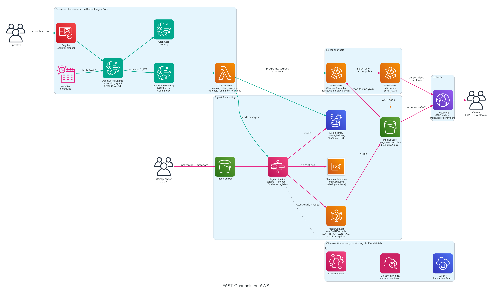
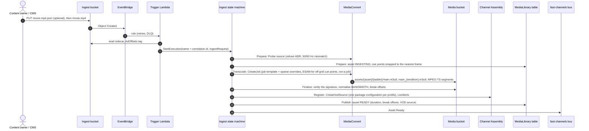
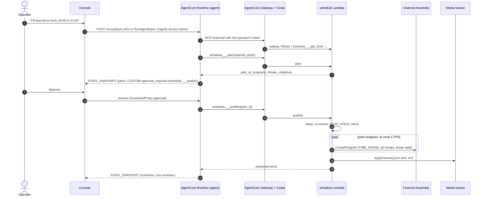
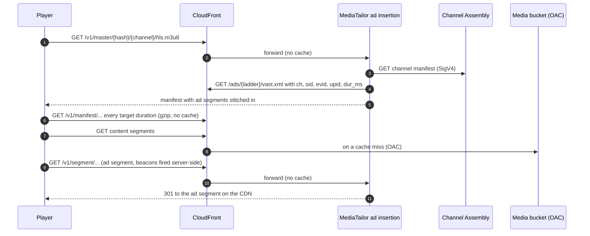

# Architecture

FAST Channels on AWS turns mezzanine files into always-on, ad-supported linear channels without a live encoder.
Every title is encoded once into plain HLS: MPEG-TS segments with H.264 video and AAC audio muxed into every variant.
AWS Elemental MediaTailor Channel Assembly plays those VOD sources as a linear schedule, MediaTailor ad insertion
stitches ads into the breaks server-side (SSAI), and Amazon CloudFront delivers everything. A scheduling agent on
Amazon Bedrock AgentCore builds the schedules through typed tools, under Cedar policies and human approval.
Optional modules, all off by default, add programmatic demand, a decision service for each ad break, show-level
metadata, a per-task model registry and the operations they need ([modules.md](modules.md)).



- [Planes and stacks](#planes-and-stacks)
- [Ownership: CloudFormation owns containers, the runtime owns contents](#ownership-cloudformation-owns-containers-the-runtime-owns-contents)
- [Flows](#flows): [ingest](#ingest), [scheduling and publishing](#scheduling-and-publishing), [playback](#playback-ssai)
- [Construct catalogue](#construct-catalogue)
- [Data model](#data-model)
- [Design principles](#design-principles)

## Planes and stacks

One CDK `Stage` (`FastChannelsStage`) holds a deployment. Its id is `FastChannels` for the default prefix `fast`, and
`FastChannels-<prefix>` otherwise, so the stacks are named `FastChannels-Data`, `FastChannels-Media` and so on
(`FastChannels-news-Data` for prefix `news`).

| Stack | Plane | Contents | Deployed |
|---|---|---|---|
| `…-Data` | Data | Ingest, media and logs buckets with their bucket policies; `MediaLibrary` and `ReferenceCatalog` DynamoDB tables; AgentCore Memory | Always, first. Termination protection and `RETAIN` with `removal: retain` |
| `…-Media` | Media | Event bus, ingest pipeline, ladders and their kits, Channel Assembly source location, IaC channels with their playback configurations, CloudFront distribution, runtime-resource reaper, dashboard and alarms | Always |
| `…-Ops` | Ops | The lake (Glue database, tables and views, Athena workgroup, MediaTailor log copies), the ledger's writer and archive stream, account quota and hook alarms, the zero-ad-sessions detector, the Channel Assembly alerts poller, the runbooks, the AppConfig kill switches and the probe canary ([observability.md](observability.md#lake)) | Only with `modules.ops.enabled`, after Data and Media |
| `…-Models` | Operator | The per-task model registry: per LLM task an application inference profile `<prefix>-<task>` and an SSM entry `/<prefix>/models/tasks/<task>`; the `<prefix>-models` spend-counter table | Only with `modules.models.enabled`, before Operator |
| `…-Operator` | Operator | Cognito, agent tool Lambdas, AgentCore Gateway with its Cedar policy engine, AgentCore Runtime, autopilot, operator console | When `agent.enabled` (default) |
| `…-Crawl` | Demand | The catalog context publisher: one object per title under `catalog/ctx/v1/` in the media bucket, kept in step with the reference catalog ([content-enrichment.md](content-enrichment.md#the-context-publisher)) | Only with `modules.crawl.enabled`, after Data and Media |
| `…-Edge-<region>` | Media | CloudFront standard-logs-v2 delivery, CDN alert topic and 5xx alarm, in us-east-1 | Only when the deployment region is not us-east-1 (otherwise these live in Media); one per deployment region |
| `…-DemandEdge` | Demand | The two origin secrets and the WAF rule group the Prebid Server guidance's web ACL references first, in us-east-1 ([demand.md](demand.md)) | Only with `modules.demand.enabled`; named `…-DemandEdge-<region>` outside us-east-1 |
| `…-DemandBuild` | Demand | The Prebid Server image repository, its x86 CodeBuild project, and the CloudFormation execution policy of the guidance's dedicated CDK bootstrap | Only with `modules.demand.enabled` |
| `…-Demand` | Demand | Beside the guidance: the private zone `<prefix>.fast.internal` in its VPC, in `lambda` mode the bidder simulator behind an internal load balancer, the census gate, the daypart scheduled actions and the warm-up of new Prebid Server tasks | Only once `make deploy-demand` has deployed the guidance (it passes the guidance's network as context) |
| `…-Pds` | Demand | The Pod Decision Service beside its sidecar (the sidecar answers Prebid Server from inside the guidance's task, ADR-0036): the snapshot publisher, delivery, the reservations' sweeper, the fallback alarms and the decision records' streams into the lake ([pds.md](pds.md#the-service)) | Only with `modules.pds.enabled`, by `make deploy-demand` right after Demand |
| `…-Release` | Release | Beside the guidance: the Release Controller (the bundle, the apply state machine, its state table, the drift check, the reaper), the siblings' KMS-encrypted log group, their hook alarms and zero-ad-sessions detector ([release-controller.md](release-controller.md)) | Only with `modules.release.enabled`, once `make deploy-demand` has deployed the guidance (after Pds) |
| `FastChannels-AccountBaseline` | Account | CloudWatch Transaction Search (1 % indexing) and its X-Ray log policy | Only by `make account-baseline`, for `observability.transaction_search: enable`; never by `make deploy` or `make destroy`. One per account and region, termination protected, retained |
| `FastChannels-AsRun` | Account | The as-run router: the one subscription on the as-run log, putting every event on the default event bus for `observability.as_run: shared` deployments; its alarms and dead-letter queue ([ADR-0032](adr/0032-shared-as-run-router.md)) | Only by `make as-run-router`, never by `make deploy` or `make destroy`. One per account and region, termination protected |

The demand module's Prebid Server is the AWS guidance, deployed as its own CDK app (`<prefix>-pbs`, and
`<prefix>-pbs-sim` with the guidance's simulator) by `make deploy-demand`, never by `make deploy`.

Dependencies run Data → Media → (Models →) Operator; Ops and Crawl follow Data and Media; DemandEdge and DemandBuild
depend on nothing; Demand follows the guidance and Pds follows Demand. Cross-stack references are *weak*
(`Fn::GetStackOutput`), so stacks can be refactored without export locks, and they also cross regions for the Edge
stack. Demand and Pds exist only when `make deploy-demand` passes the guidance's network, so Pds reads the Data stack's
names from SSM parameters instead: a weak reference would break whenever `make deploy` synthesizes Data without Pds.
[modules.md](modules.md#deploy-and-destroy-order) gives the deploy and destroy order. Memory lives in the Data stack so
that an Operator rollback can never get stuck on a Memory that is still `CREATING`.

The Data stack owns every bucket policy. Consumer stacks never add statements to it: the policy admits CloudFront
distributions of the account, the deployment's own Channel Assembly source location (`<prefix>-media`) and log
delivery through synth-time ARNs and patterns, so no cross-stack cycle can form.

### Stack outputs

Scripts, the e2e tests and these docs use these CloudFormation output keys.

| Stack | Outputs |
|---|---|
| Data | `IngestBucketName`, `MediaBucketName`, `LogsBucketName`, `LibraryTableName`, `CatalogTableName`, `MemoryId`; with `ops`, `LakeBucketName`, `LedgerTableName`, `LedgerArchiveBucketName`; with `pds`, `PdsTableName`, `PdsConfigBucketName` |
| Media | `CdnBaseUrl`, `ContentBaseUrl`, `EventBusName`, `IngestStateMachineArn`, `LadderProvisionerArn`, `SourceLocationName`, `DefaultLadderVersion`, `Channels` (JSON: `[{name, ladderVersion, outputs, playback: {<output>: <SSAI URL>}}]`), `DashboardUrl`, `DashboardName`, `DistributionId`, `PathContract` |
| Ops | `LakeDatabase`, `LakeWorkGroup`, `AppConfigApplicationId`, `AppConfigEnvironmentId`, `LedgerStreamName` |
| Models | `TaskParameters` (JSON `{task: SSM parameter name}`), `TaskProfiles` (JSON `{task: inference profile ARN}`), `CounterTableName` |
| Operator | `ConsoleUrl`, `UserPoolId`, `ConsoleClientId`, `AutopilotClientId` (only with an `autopilot_cron` or `agent.machine_client`), `CognitoDomain`, `RuntimeArn`, `RuntimeInvokeUrl`, `GatewayUrl`, `ToolFunctions` (JSON `{target: function name}`), `ModelSpecParameter` (not with `modules.models`) |
| Crawl | `CatalogContextBaseUrl`, `CatalogContextPublisherName` |
| DemandEdge | `OriginRuleGroupArn`, `OriginSecretAArn`, `OriginSecretBArn` |
| DemandBuild | `ImageRepositoryUri`, `ImageBuildProject`, `GuidanceExecutionPolicyArn`; with `pds`, `PdsImageRepositoryUri` |
| Demand | `PrivateZoneId`, `CensusGateArn`, `WarmUpProjectName`, `SimulatorFunction` (`lambda` mode only) |
| Pds | `DecisionLogGroup` (the sidecar's), `DeliveryFunction`, `SweeperFunction`, `PublisherFunction`, `ConfigBucketName`, `TableName` |

```bash
aws cloudformation describe-stacks --stack-name FastChannels-Media \
  --query "Stacks[0].Outputs[?OutputKey=='CdnBaseUrl'].OutputValue" --output text
```

## Ownership: CloudFormation owns containers, the runtime owns contents

| Owned by CloudFormation (`fast:owner=iac`) | Created at runtime |
|---|---|
| Buckets, tables, Memory | Objects and items |
| The Channel Assembly source location | VOD sources (`fast:owner=pipeline`), BYO source locations (`agent`) |
| Channels in `cdk.json` (`channels.iac`) and their playback configurations | Programs; agent channels `<prefix>-agent-*` with their playback configurations and log deliveries (`agent`) |
| MediaConvert job templates of the built-in ladders | Job templates of agent-provisioned ladders (`agent`) |
| The kit's provisioning custom resource | The kit's VOD sources and ad manifests (`pipeline`) |

Every runtime resource carries `fast:app=<prefix>` and `fast:owner=pipeline|agent` (plus `fast:ladder` and
`fast:correlation-id` where they apply). On stack deletion, the `RuntimeResourceReaper` custom resource deletes them
*before* the containers they would otherwise block: agent channels (stop, delete programs, policy, playback
configuration and deliveries), VOD sources at the 1 TPS quota, runtime source locations and runtime job templates.
It does nothing with `removal: retain`, and nothing during updates or update rollbacks. This removes the
`DELETE_FAILED` teardown that v1 and v2 suffered from.

IaC channels have their own lifecycle custom resource: on update it fails fast while the channel is `RUNNING` (unless
`restart_on_update`), and on delete it stops the channel and deletes its programs first. Channels are never started by
a deployment. Both drain channels within their function's time budget, and only of the programs Channel Assembly can
still hold, so a teardown that runs out of time resumes on the next attempt instead of starting over.

## Flows

### Ingest

A file lands in the ingest bucket (or a tool or event asks for an ingest); a Step Functions Standard workflow encodes
it with the ladder's job template and registers the result with Channel Assembly. The execution name is the
correlation id that every later log line carries.



The same pipeline encodes a ladder's *kit* (filler slate, break slates and house ads) as child executions of the
`LadderProvisioner` state machine; see [encoding.md](encoding.md#ladder-kits).

### Scheduling and publishing

The operator asks in the console; the agent plans with tools, shows the plan, asks for approval and publishes. Tools
compute every start time, break offset and SCTE-35 id; the model only chooses titles and order.



The autopilot follows the same path with a machine token on a schedule; Cedar limits it to read tools plus
`schedule___plan` and `schedule___publish`. See [agent.md](agent.md).

### Playback: SSAI

One playback configuration per channel (`InsertionMode: STITCHED_ONLY`) stitches the ads into a personalised manifest
per viewing session.



The channel policy admits only the channel's own playback configurations (SigV4: the channel's one, plus its
siblings `<channel>-p-?` when the release module monetizes it), so viewers cannot read Channel Assembly output
without ad insertion, and CloudFront's bucket policy denies the content manifests under `assets/`. See
[ad-insertion.md](ad-insertion.md) and [delivery-and-multi-cdn.md](delivery-and-multi-cdn.md).

## Construct catalogue

All constructs are in `infra/src/fast_channels/infra/constructs/`. Each one is a plain L2-based construct with
documented props; see the module docstrings for details. The `encoding` and `channel_assembly` packages re-export
their constructs, so `from fast_channels.infra.constructs.encoding import EncodingLadder` works as well as the full
module path.

| Module | Construct | What it creates |
|---|---|---|
| `storage` | `MediaStorage` | Ingest, media and logs buckets (SSE-S3, bucket-owner enforced, TLS only); `allow_cloudfront_read()`, `allow_channel_assembly_read(source_location)`, `allow_log_delivery()` |
| | `MediaLibrary`, `ReferenceCatalogTable` | `TableV2` tables (on demand, PITR, TTL `expires_at`, `GSI1`) |
| `functions` | `FastFunction` | Python 3.14 arm64 Lambda from the shared workspace bundle, JSON logs, explicit log group with retention, active tracing; `allow()` adds a least-privilege statement |
| `encoding.ladder` | `EncodingLadder` | MediaConvert job template of one ladder version |
| `encoding.pipeline` | `IngestPipeline` | MediaConvert queue and role, ingest state machine, trigger rules, DLQ |
| `encoding.kits` | `LadderProvisioner`, `LadderKit` | Kit state machine; deploy-time custom resource, idempotent by fingerprint |
| `channel_assembly.origin` | `ChannelAssemblyOrigin` | `S3_SIGV4` source location on the media bucket |
| `channel_assembly.ad_insertion` | `MediaTailorLogs` | `/aws/vendedlogs/mediatailor/<prefix>` and its delivery destination |
| | `AdInsertion` | Playback configuration with three vended-log deliveries |
| `channel_assembly.channel` | `LinearChannel` | LINEAR channel, its `AdInsertion`, SigV4-only channel policy, lifecycle custom resources |
| `channel_assembly.as_run` | `AsRunLogging` | As-run log retention and the reconciler that marks programs `AIRED`; with `ops`, breaks `AIRED` from `AdBreakStart` and the sweep that marks the rest `UNAIRED` |
| | `AsRunRouter` | The account's only subscription on the as-run log, putting every event on the default event bus (AsRun stack only) |
| `channel_assembly.reaper` | `RuntimeResourceReaper` | Delete-first cleanup of runtime resources |
| `delivery` | `MediaDistribution` | CloudFront distribution driven by `ROUTES` (OAC to S3, MediaTailor origins) and its path contract |
| | `CdnAccessLogs` | Standard logs v2 to S3 (Parquet, Hive partitions) |
| `events` | `FastEventBus` | `<prefix>-fast-channels` bus with archive and logs |
| `observability` | `MediaObservability`, `ChannelCensus` | Dashboard, alarms (including the dead-letter queues), MediaConvert job logs, saved trace queries, running-channel census |
| `observability_baseline` | `TransactionSearch` | Account-level Transaction Search (AccountBaseline stack only) |
| `operator.identity` | `OperatorIdentity` | Cognito Essentials pool, groups, managed login, console client; the autopilot's machine client only with an autopilot |
| `operator.tools` | `AgentTools` | One tool Lambda per registry target with least-privilege IAM; auto-stop scheduler group |
| `operator.gateway` | `AgentGateway` | MCP Gateway (CUSTOM_JWT) with its own conditioned service role, Lambda targets, Cedar policy engine in `ENFORCE` mode |
| `operator.runtime` | `SchedulerAgent` | AgentCore Runtime (code zip, AG-UI), ModelSpec parameter, online evaluations with traces |
| `models.registry` | `ModelRegistry` | One validated registry entry per task (SSM), with models only from the allow-list |
| `models.profiles` | `TaskProfiles` | One application inference profile per task; `task_invoke_statements` grants a role its task's profile only |
| `models.caps` | `SpendCounters`, `TaskBudget` | The daily spend-counter table and its item-level grant; the optional AWS Budgets action per task role |
| `operator.deliveries` | `AgentTelemetry` | Vended logs (and traces) of Gateway, Memory and Runtime |
| `operator.autopilot` | `Autopilot` | Scheduler schedules per channel, autopilot Lambda, DLQ, error and dead-letter alarms |
| `operator.console` | `OperatorConsole` | Private bucket, CloudFront with OAC and CSP, `config.json` |
| `ops.lake` | `LakeBucket`, `Lake` | The lake bucket (Data stack); the Glue database, tables and views, Athena workgroup and MediaTailor log copies |
| `ops.ledger` | `LedgerStorage`, `LedgerWriter` | The ledger table and its Object-Locked archive bucket (Data stack); the stream writer that chains entries, and the Firehose stream into the archive |
| `ops.detectors` | `AccountQuotaAlarms`, `ConfigurationAlarms`, `ZeroAdsDetector`, `AlertsPoller` | Account quota alarms, per-configuration hook alarms, the hourly zero-ad-sessions detector, the per-minute Channel Assembly alerts poller |
| `ops.runbooks` | `Runbooks` | The runbooks' function, one state machine per runbook and their triggers |
| `ops.flags` | `OpsAppConfig` | AppConfig application `<prefix>-fast` with its `flags` feature-flag profile |
| `ops.canary` | `ProbeCanary` | The probe canary, its census-driven start and stop, and its off-air alarm |
| `demand.origin_waf` | `OriginGate` | The origin secrets and the WAF rule group that requires one of them |
| `demand.image_build` | `ImageBuild` | The Prebid Server image repository (and with `modules.pds` the sidecar's) and their x86 build project |
| `demand.guidance_bootstrap` | `GuidanceExecutionPolicy` | The execution policy of the guidance's dedicated CDK bootstrap |
| `demand.private_dns` | `PrivateDns` | The private hosted zone `<prefix>.fast.internal` |
| `demand.simulator` | `LambdaSimulator` | The bidder simulator as a function behind an internal load balancer (`lambda` mode) |
| `demand.scaling` | `CensusGate`, `Dayparts` | Prebid Server's task minimum by the running channels; scheduled actions ahead of dayparts |
| `demand.warmup` | `WarmUp` | The warm-up project and the rule that starts it for every new Prebid Server task |
| `pds.tables`, `pds.config_bucket` | `PdsTable`, `ConfigBucket`, `SnapshotPublisher` | The PDS table and private config bucket (Data stack); the snapshot publisher (Pds stack) |
| `pds.decisions` | `DecisionLog` | One kind of decision record into the lake |
| `crawl.publisher` | `ContextPublisher` | The catalog context publisher and its triggers |

Shared recipes next to them: `alerts` (alert topic, alarms, CDN metrics), `logs` (service and vended log groups,
log deliveries), `queues` (dead-letter queues) and `_provider` (custom-resource providers); and in
`fast_channels.infra`, `exports` (the `DataExports`, `MediaExports` and `ChannelExports` that stacks hand to each
other), `grants` and `arns`.

Pure logic (ladder validation, MediaConvert settings, timelines, MediaTailor request shapes, VAST) lives in
`fast_channels.core`, which both the CDK app and the Lambda tools import, so the IaC channels and the agent-created
channels are built from the same functions (`core.specs`).

## Data model

`MediaLibrary` is a single table (`pk`, `sk`, `GSI1` on `gsi1pk`/`gsi1sk`).

| Entity | `pk` | `sk` | GSI1 |
|---|---|---|---|
| Asset | `ASSET#<asset_id>` | `LADDER#<ladder_version>` | `KIND#<kind>#<ladder_version>` / `<status>#<updated_at>` |
| Ladder version | `LADDER#<ladder_id>` | `V#<ladder_version>` | `LADDERS` / `<status>#<ladder_version>` |
| Ladder proposal | `PROPOSAL#<id>` | `META` (TTL 24 h) | |
| Channel | `CHANNEL#<name>` | `META` | `CHANNELS` / `<owner>#<name>` |
| Program (schedule of record) | `CHANNEL#<name>` | `PROGRAM#<start_ms:013d>` (TTL 30 days after its end) | `PROGRAM#<program_name>` / `<channel>` |
| Plan | `CHANNEL#<name>` | `PLAN#<plan_id>` (TTL 1 h) | |
| Publish lease | `CHANNEL#<name>` | `LEASE` (TTL) | |

`ReferenceCatalog` holds `CONTENT#<content_id>` / `META` items (GSI1 `GENRE#<genre>` / `<title>`).

Media bucket keys: `assets/<asset_id>/<ladder>/main*.m3u8` plus MPEG-TS segments (`.ts`); `ads/<ladder>/vast.xml`,
`ads/<ladder>/<creative_id>/…` (copies of the ad manifests, which MediaTailor reads) and `ads/b.gif`;
`epg/<channel>.json|.xml`. In keys a ladder version `standard@843ed1d05a` is written `standard_843ed1d05a`.

Domain events on the `<prefix>-fast-channels` bus (source `fast-channels.<prefix>`, schema in
[`contracts/events.schema.json`](../contracts/events.schema.json)): `Ingest Requested` (in), `Asset Ready`,
`Asset Failed`, `Ladder Ready`, `Ladder Failed`, `Schedule Published`, `Autopilot Run`, `Catalog Item Changed` (in;
your CMS sync job or `make seed`), and with the ops module `Census Changed` and `Channel Alert`.

## Design principles

1. **Re-use.** Stable CDK L2 constructs first, L1 only where no L2 exists, no alpha modules on the default path, no
   AWS Solutions Constructs ([ADR-0002](adr/0002-l2-constructs-over-solutions-constructs.md)).
2. **One source of truth per concept**: the ladder model compiles job templates and validates agent proposals; the
   tool registry generates Gateway schemas, Cedar policies and the [tool table](agent.md#tool-reference); `core.specs`
   builds every MediaTailor resource; `ROUTES` builds CloudFront and the CDN path contract.
3. **Tools do arithmetic and validation; the model only chooses.**
4. **Every service logs** to CloudWatch (or S3 for the CDN) with retention, traces where it can, and one correlation
   id threads it all ([observability.md](observability.md)).
5. **Cost-safe by default**: channels never start on deploy, started channels stop after four hours, vended logs and
   Transaction Search are opt-in or sampled.

Each significant decision has an [architecture decision record](adr/README.md).
