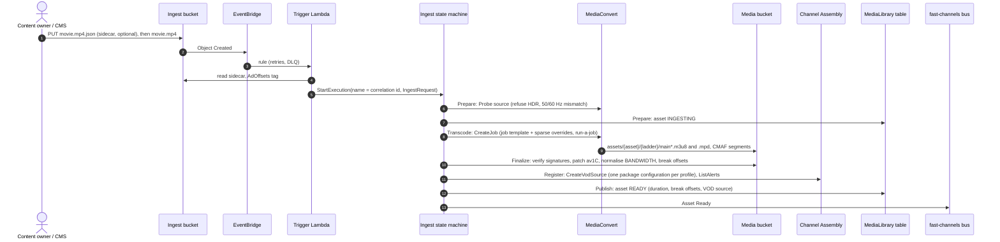
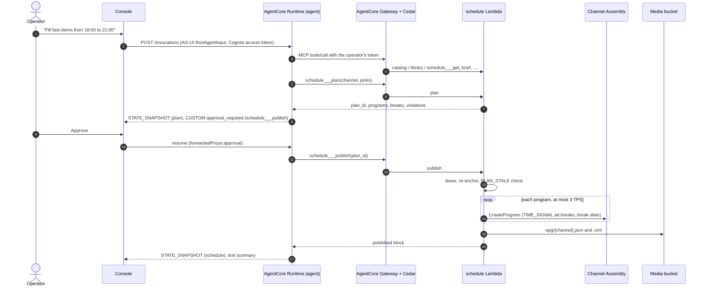
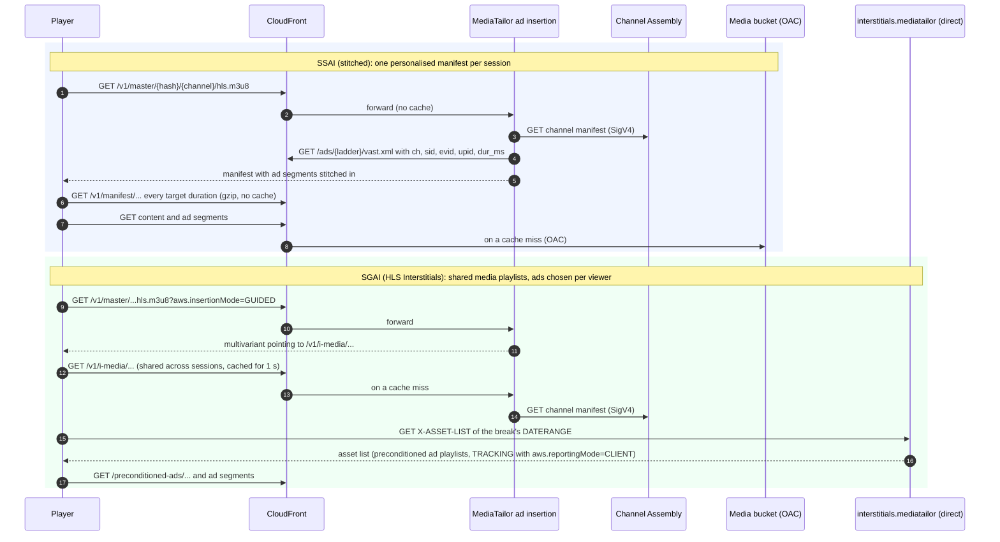

# Architecture

FAST Channels on AWS turns mezzanine files into always-on, ad-supported linear channels without a live encoder.
Every title is encoded once into CMAF. AWS Elemental MediaTailor Channel Assembly plays those VOD sources as a linear
schedule, MediaTailor ad insertion fills the breaks (server-side or server-guided), and Amazon CloudFront delivers
everything. A scheduling agent on Amazon Bedrock AgentCore builds the schedules through typed tools, under Cedar
policies and human approval.


- [Planes and stacks](#planes-and-stacks)
- [Ownership: CloudFormation owns containers, the runtime owns contents](#ownership-cloudformation-owns-containers-the-runtime-owns-contents)
- [Flows](#flows): [ingest](#ingest), [scheduling and publishing](#scheduling-and-publishing), [playback](#playback-ssai-and-sgai)
- [Construct catalogue](#construct-catalogue)
- [Data model](#data-model)
- [Design principles](#design-principles)

## Planes and stacks

One CDK `Stage` (`FastChannelsStage`) holds a deployment. Its id is `FastChannels` for the default prefix `fast`, and
`FastChannels-<prefix>` otherwise, so the stacks are named `FastChannels-Data`, `FastChannels-Media` and so on
(`FastChannels-news-Data` for prefix `news`).

| Stack | Plane | Contents | Deployed |
|---|---|---|---|
| `…-Data` | Data | Ingest, media and logs buckets with their bucket policies; `MediaLibrary` and `ReferenceCatalog` DynamoDB tables; AgentCore Memory | Always, first. Termination protection and `RETAIN` with `removal: retain` |
| `…-Media` | Media | Event bus, ingest pipeline, ladders and their kits, Channel Assembly source location, IaC channels with their playback configurations, CloudFront distribution, runtime-resource reaper, dashboard and alarms | Always |
| `…-Operator` | Operator | Cognito, agent tool Lambdas, AgentCore Gateway with its Cedar policy engine, AgentCore Runtime, autopilot, operator console | When `agent.enabled` (default) |
| `…-Edge-<region>` | Media | CloudFront standard-logs-v2 delivery, CDN alert topic and 5xx alarm, in us-east-1 | Only when the deployment region is not us-east-1 (otherwise these live in Media); one per deployment region |
| `FastChannels-AccountBaseline` | Account | CloudWatch Transaction Search (1 % indexing) and its X-Ray log policy | Only with `observability.transaction_search: enable`. One per account and region, termination protected, retained |

Dependencies run Data → Media → Operator. Cross-stack references are *weak* (`Fn::GetStackOutput`), so stacks can be
refactored without export locks, and they also cross regions for the Edge stack. Memory lives in the Data stack so
that an Operator rollback can never get stuck on a Memory that is still `CREATING`.

The Data stack owns every bucket policy. Consumer stacks never add statements to it: the policy admits CloudFront
distributions of the account, Channel Assembly source locations named `<prefix>*` and log delivery through
synth-time ARN patterns, so no cross-stack cycle can form.

### Stack outputs

Scripts, the e2e tests and these docs use these CloudFormation output keys.

| Stack | Outputs |
|---|---|
| Data | `IngestBucketName`, `MediaBucketName`, `LogsBucketName`, `LibraryTableName`, `CatalogTableName`, `MemoryId` |
| Media | `CdnBaseUrl`, `ContentBaseUrl`, `EventBusName`, `IngestStateMachineArn`, `LadderProvisionerArn`, `SourceLocationName`, `DefaultLadderVersion`, `Channels` (JSON: `[{name, ladderVersion, outputs, playback: {<output>: {ssai?, sgai?, dash?}}}]`), `DashboardUrl`, `DistributionId`, `PathContract` |
| Operator | `ConsoleUrl`, `UserPoolId`, `ConsoleClientId`, `AutopilotClientId`, `CognitoDomain`, `RuntimeArn`, `RuntimeInvokeUrl`, `GatewayUrl`, `ToolFunctions` (JSON `{target: function name}`), `ModelSpecParameter` |

```bash
aws cloudformation describe-stacks --stack-name FastChannels-Media \
  --query "Stacks[0].Outputs[?OutputKey=='CdnBaseUrl'].OutputValue" --output text
```

## Ownership: CloudFormation owns containers, the runtime owns contents

| Owned by CloudFormation (`fast:owner=iac`) | Created at runtime |
|---|---|
| Buckets, tables, Memory | Objects and items |
| The Channel Assembly source location | VOD sources (`fast:owner=pipeline`), BYO source locations (`agent`) |
| Channels in `cdk.json` (`channels.iac`) and their playback configurations | Programs; agent channels `<prefix>-agent-*` with their playback configurations and log deliveries (`agent`) |
| MediaConvert job templates of the built-in ladders | Job templates of agent-provisioned ladders (`agent`) |
| The kit's provisioning custom resource | The kit's VOD sources and ad manifests (`pipeline`) |

Every runtime resource carries `fast:app=<prefix>` and `fast:owner=pipeline|agent` (plus `fast:ladder` and
`fast:correlation-id` where they apply). On stack deletion, the `RuntimeResourceReaper` custom resource deletes them
*before* the containers they would otherwise block: agent channels (stop, delete programs, policy, playback
configuration and deliveries), VOD sources at the 1 TPS quota, runtime source locations and runtime job templates.
It does nothing with `removal: retain`, and nothing during updates or update rollbacks. This removes the
`DELETE_FAILED` teardown that v1 and v2 suffered from.

IaC channels have their own lifecycle custom resource: on update it fails fast while the channel is `RUNNING` (unless
`restart_on_update`), and on delete it stops the channel and deletes its programs first. Channels are never started by
a deployment.

## Flows

### Ingest

A file lands in the ingest bucket (or a tool or event asks for an ingest); a Step Functions Standard workflow encodes
it with the ladder's job template and registers the result with Channel Assembly. The execution name is the
correlation id that every later log line carries.



The same pipeline encodes a ladder's *kit* (filler slate, break slates and house ads) as child executions of the
`LadderProvisioner` state machine; see [encoding.md](encoding.md#ladder-kits).

### Scheduling and publishing

The operator asks in the console; the agent plans with tools, shows the plan, asks for approval and publishes. Tools
compute every start time, break offset and SCTE-35 id; the model only chooses titles and order.



The autopilot follows the same path with a machine token on a schedule; Cedar limits it to read tools plus
`schedule___plan` and `schedule___publish`. See [agent.md](agent.md).

### Playback: SSAI and SGAI

One playback configuration per channel (`InsertionMode: PLAYER_SELECT`) serves both modes. The player chooses with a
query string; DASH is always SSAI.



The channel policy admits only the channel's own playback configuration (SigV4), so viewers cannot read Channel
Assembly output without ad insertion, and CloudFront's bucket policy denies the content manifests under `assets/`. See
[ad-insertion.md](ad-insertion.md) and [delivery-and-multi-cdn.md](delivery-and-multi-cdn.md).

## Construct catalogue

All constructs are in `infra/src/fast_channels/infra/constructs/`. Each one is a plain L2-based construct with
documented props; see the module docstrings for details.

| Module | Construct | What it creates |
|---|---|---|
| `storage` | `MediaStorage` | Ingest, media and logs buckets (SSE-S3, bucket-owner enforced, TLS only); `allow_cloudfront_read()`, `allow_channel_assembly_read(prefix)`, `allow_log_delivery()` |
| | `MediaLibrary`, `ReferenceCatalogTable` | `TableV2` tables (on demand, PITR, TTL `expires_at`, `GSI1`) |
| `functions` | `FastFunction` | Python 3.14 arm64 Lambda from the shared workspace bundle, JSON logs, explicit log group with retention, active tracing |
| `encoding` | `EncodingLadder` | MediaConvert job template of one ladder version |
| | `IngestPipeline` | MediaConvert queue and role, ingest state machine, trigger rules, DLQ |
| | `LadderProvisioner`, `LadderKit` | Kit state machine; deploy-time custom resource, idempotent by fingerprint |
| `channel_assembly` | `ChannelAssemblyOrigin` | `S3_SIGV4` source location on the media bucket |
| | `MediaTailorLogs` | `/aws/vendedlogs/mediatailor/<prefix>` and its delivery destination |
| | `AdInsertion` | Playback configuration with three vended-log deliveries |
| | `LinearChannel` | LINEAR channel, its `AdInsertion`, SigV4-only channel policy, lifecycle custom resources |
| | `AsRunLogging` | As-run log retention and the reconciler that marks programs `AIRED` |
| | `RuntimeResourceReaper` | Delete-first cleanup of runtime resources |
| `delivery` | `MediaDistribution` | CloudFront distribution driven by `ROUTES` (OAC to S3, MediaTailor origins) and its path contract |
| | `CdnAccessLogs` | Standard logs v2 to S3 (Parquet), optionally to CloudWatch Logs |
| `observability` | `FastEventBus` | `<prefix>-fast-channels` bus with archive and logs |
| | `MediaObservability`, `ChannelCensus` | Dashboard, alarms, MediaConvert job logs, saved trace queries, running-channel census |
| `observability_baseline` | `TransactionSearch` | Account-level Transaction Search (AccountBaseline stack only) |
| `operator.identity` | `OperatorIdentity` | Cognito Essentials pool, groups, managed login, console and autopilot clients |
| `operator.tools` | `AgentTools` | One tool Lambda per registry target with least-privilege IAM; auto-stop scheduler group |
| `operator.gateway` | `AgentGateway` | MCP Gateway (CUSTOM_JWT), Lambda targets, Cedar policy engine in `ENFORCE` mode |
| `operator.runtime` | `SchedulerAgent` | AgentCore Runtime (code zip, AG-UI), ModelSpec parameter, online evaluations with traces |
| `operator.deliveries` | `AgentTelemetry` | Vended logs (and traces) of Gateway, Memory and Runtime |
| `operator.autopilot` | `Autopilot` | Scheduler schedules per channel, autopilot Lambda, DLQ |
| `operator.console` | `OperatorConsole` | Private bucket, CloudFront with OAC and CSP, `config.json` |

Pure logic (ladder validation, MediaConvert settings, timelines, MediaTailor request shapes, VAST) lives in
`fast_channels.core`, which both the CDK app and the Lambda tools import, so the IaC channels and the agent-created
channels are built from the same functions (`core.specs`).

## Data model

`MediaLibrary` is a single table (`pk`, `sk`, `GSI1` on `gsi1pk`/`gsi1sk`).

| Entity | `pk` | `sk` | GSI1 |
|---|---|---|---|
| Asset | `ASSET#<asset_id>` | `LADDER#<ladder_version>` | `KIND#<kind>#<ladder_version>` / `<status>#<updated_at>` |
| Ladder version | `LADDER#<ladder_id>` | `V#<ladder_version>` | `LADDERS` / `<status>#<ladder_version>` |
| Ladder proposal | `PROPOSAL#<id>` | `META` (TTL 24 h) | |
| Channel | `CHANNEL#<name>` | `META` | `CHANNELS` / `<owner>#<name>` |
| Program (schedule of record) | `CHANNEL#<name>` | `PROGRAM#<start_ms:013d>` | `PROGRAM#<program_name>` / `<channel>` |
| Plan | `CHANNEL#<name>` | `PLAN#<plan_id>` (TTL 1 h) | |
| Publish lease | `CHANNEL#<name>` | `LEASE` (TTL) | |

`ReferenceCatalog` holds `CONTENT#<content_id>` / `META` items (GSI1 `GENRE#<genre>` / `<title>`).

Media bucket keys: `assets/<asset_id>/<ladder>/main*.m3u8|.mpd` plus CMAF segments; `ads/<ladder>/vast.xml`,
`ads/<ladder>/<creative_id>/…` (SGAI-ready ad manifests) and `ads/b.gif`; `epg/<channel>.json|.xml`. In keys a ladder
version `standard@86bf8088e0` is written `standard_86bf8088e0`.

Domain events on the `<prefix>-fast-channels` bus (source `fast-channels.<prefix>`, schema in
[`contracts/events.schema.json`](../contracts/events.schema.json)): `Ingest Requested` (in), `Asset Ready`,
`Asset Failed`, `Ladder Ready`, `Ladder Failed`, `Schedule Published`, `Autopilot Run`.

## Design principles

1. **Re-use.** Stable CDK L2 constructs first, L1 only where no L2 exists, no alpha modules on the default path, no
   AWS Solutions Constructs ([ADR-0002](adr/0002-l2-constructs-over-solutions-constructs.md)).
2. **One source of truth per concept**: the ladder model compiles job templates and validates agent proposals; the
   tool registry generates Gateway schemas, Cedar policies and the [tool table](agent.md#tool-reference); `core.specs`
   builds every MediaTailor resource; `ROUTES` builds CloudFront and the CDN path contract.
3. **Tools do arithmetic and validation; the model only chooses.**
4. **Every service logs** to CloudWatch (or S3 for the CDN) with retention, traces where it can, and one correlation
   id threads it all ([observability.md](observability.md)).
5. **Cost-safe by default**: channels never start on deploy, started channels stop after four hours, vended logs and
   Transaction Search are opt-in or sampled.

Each significant decision has an [architecture decision record](adr/README.md).
