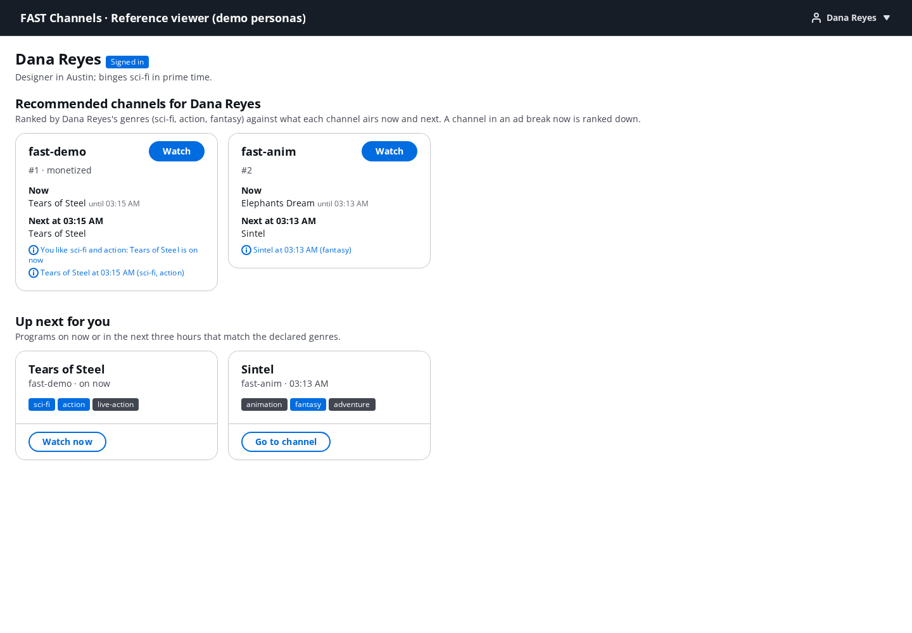

# Reference viewer: personas, a channel rail and the ad panel

The `viewer` module (`modules.viewer`, [ADR 0028](adr/0028-reference-viewer-on-its-own-origin.md)) deploys a small web
app that shows the monetization modules from a viewer's side. The demo personas sign in to the viewer pool, each gets
a rail of recommended channels, and each plays the same channel on a playback ticket of their own. With
`modules.viewer.ad_panel`, a "why these ads" panel shows what the Pod Decision Service (PDS) decided for each break of
the viewer's own session: the privacy mode, the value tier, the ad-load policy and the pod.

On the demo's prices, Dana (the `light` tier) gets one $35 ad and the channel's slate in a break where Marcus
(`standard`) gets the full pod ([pds.md](pds.md#ad-load-by-tier)).



- [What it deploys](#what-it-deploys)
- [Turning it on](#turning-it-on)
- [Personas and sign-in](#personas-and-sign-in)
- [The rail](#the-rail)
- [Playback](#playback)
- [The ad panel](#the-ad-panel)
- [Demo script (10 minutes)](#demo-script-10-minutes)
- [What it costs](#what-it-costs)
- [Limits](#limits)
- [Developing the app](#developing-the-app)

## What it deploys

| Part | What it is |
|---|---|
| The app | A second build of the `console/` package (`vite build --mode viewer`, `console/dist-viewer`): React and Cloudscape, the console's hls.js player and EPG readers. Hash routes: `#/personas` (who's watching), `#/` (the rails) and `#/watch/<channel>` |
| `FastChannels-<prefix>-Viewer` | A private S3 bucket behind its own CloudFront distribution (OAC), with a response headers policy carrying the app's CSP, and the app's `config.json`. The hosting is the operator console's (`StaticSite`), on an origin of its own: viewer and operator tokens never share one |
| The ad panel API (`ad_panel`) | An API Gateway HTTP API, `GET /sessions/{sid}/breaks`, behind a JWT authorizer for the viewer pool's access tokens, and a Lambda function that reads the PDS's decision records with CloudWatch Logs Insights |

The viewer pool, its client, the playback API (`POST /playback`) and the demo users are the identity module's.
`config.json` names them, the media CDN, the IaC channels (the release module's lab channel left out) and the demo
personas' public fields. It holds no tier.

The app's CSP allows scripts and styles from its own origin only, and `connect-src` lists exactly what it calls: the
media CDN (and the content domain, when it has one), `https://cognito-idp.<region>.amazonaws.com`, the playback API and
the ad panel API.

## Turning it on

```json
"modules": {
  "viewer": { "enabled": true, "ad_panel": true }
}
```

- `viewer` needs the identity module, which needs `release` (and so `pds`, `demand` and `ops`). Synth refuses
  otherwise. The shipped stages (`fastm`, `fastci`, `fastciads`) turn it on with the panel.
- `make deploy` builds the app (`make console` builds the console and the viewer) and deploys the Viewer stack after
  Identity. Monetized channels play on tickets once `make deploy-demand` has deployed the Release stack; before
  that the mint answers `not_released` and the app plays each channel's v3.0.0 URL. The ad panel reads the PDS
  sidecar's log group, which `make deploy-demand` creates; until then it answers that nothing was decided.
- Seed the demo users once per stage. `scripts/seed_personas.py` creates the signed-in personas in the viewer pool,
  writes their tier profiles for the PDS and keeps their passwords in Secrets Manager:

  ```bash
  uv run python scripts/seed_personas.py --prefix <prefix>
  aws secretsmanager get-secret-value --secret-id <prefix>/identity/demo-users --query SecretString --output text
  ```

- The stack's outputs are `ViewerUrl` (the app) and, with the panel, `AdPanelUrl`.
- Before `make destroy`, run `uv run python scripts/seed_personas.py --prefix <prefix> --delete`: the demo users'
  secret outlives the stage otherwise ([identity.md](identity.md)).

## Personas and sign-in

`contracts/personas.json` (`fast_channels.core.personas`) is the one list of demo personas. The app reads each
persona's id, name, bio, sign-in kind, email and declared genres; the tier, value and tolerance labels stay with the
seed script and the PDS.

| Persona | Signs in as | Genres | Tier (PDS profile) |
|---|---|---|---|
| Dana Reyes | `dana@personas.example.com` | sci-fi, action, fantasy | `light` |
| Ben Okafor, Dana's twin | `ben@personas.example.com` | sci-fi, action, fantasy | `holdout` |
| Marcus Hale | `marcus@personas.example.com` | live-action, action | `standard` |
| Luis Moreno | `luis@personas.example.com` | animation, surreal | `standard` |
| Priya Shah | `priya@personas.example.com` | fantasy, adventure | `standard` |
| Sam Lee | `sam@personas.example.com` | animation, sci-fi | `standard` |
| Mia (kids profile) | Marcus's sign-in | animation | none |
| Guest | no sign-in | none | none |

- **Sign-in** is Cognito `InitiateAuth` with `USER_PASSWORD_AUTH` on the identity module's public client, called
  from the browser. There is no hosted page or redirect. The pool's pre-token-generation trigger adds the scope
  `fast/playback` to the access token, and the app sends only that token: the playback API refuses ID tokens. The
  app reads the persona from the ID token's `custom:persona`, so it always shows who the API sees.
- **Tokens** are kept in `sessionStorage`, one set per tab. Open each persona in its own window to compare them side
  by side. A tab opened from another one may copy its storage, so open a new window rather than a new tab from the
  app.
- **A guest** never signs in: each play mints a guest ticket (`POST <playback API>playback/guest`), whose sessions
  are CONTEXTUAL on the control plan, and opted out when the browser sends Global Privacy Control.
- **A kids profile** (Mia) signs in with its account's sign-in (Marcus's) and plays every channel as the kids
  profile: `POST /playback` with `profile: "kids"` answers the kids twin, KIDS with no ticket; the session panel
  says "KIDS, no ticket" and there is no "why these ads" panel, because a KIDS session has no viewer id. A
  child-directed channel plays the same way for everyone.
- **Privacy choices** (`#/privacy`, in the persona menu): a signed-in viewer records whether they opt out of sale and
  sharing and whether they give the video-privacy consent (`PUT <playback API>consent`). Until they choose, their
  breaks are SAFE, own-book and house ads only, and the home page says so. `scripts/seed_personas.py` records the
  demo personas' choices from their modes; Priya opts out live here.

## The rail

The rail is rule-based, the genre baseline of DESIGN §15. It ranks each persona's channels in the browser, from the
public EPG feeds (`epg/<channel>.json`) and the persona's declared genres; no viewer data leaves the page and no model
is called (`console/src/viewer/rail.ts`).

- A channel scores the persona's affinity with its program on now, plus half the next program's and a quarter of
  the best later one's, within three hours. Affinity sums the weights of the matched genres, which fall with the
  genre's rank: 1, 2/3, 1/2, 2/5 and so on.
- A channel in an ad break now ranks lower (×0.75) and says when it is back: a viewer sent there would start on ads.
  The rail ranks again every 5 s.
- Every tile carries its reasons, such as "You like sci-fi and action: Tears of Steel is on now".
- "Up next for you" lists programs on now or in the next three hours that match the declared genres, best match
  first, each title once.
- Without declared genres (the guest), channels rank by whether they air something now, then by name.

With the `recs` module ([recs.md](recs.md)), "Recommended for you" replaces "Up next for you". The app asks
`GET /rail` (`config.json`'s `railUrl`) with the viewer's access token and shows that rail.
- **The header** says how the rail was made and why: "Recommended by Claude Haiku 5.5", "Picked for this audience
  (no personal data)", or "Rule-based rail from your genres", each with its reason, such as the holdout or a model
  rail being built.
- **Each tile** shows the model's reason, or its evidence's template where the validator replaced it.
- **When `GET /rail` fails,** the app falls back to its own rule-based rail. The recommender's fallback is a Python
  port of the same function, kept identical by `contracts/fixtures/rail/program-rail.json`.

## Playback

- **One ticket per open.** For a monetized channel (`modules.release.channels`) the player calls
  `POST <playback API>playback {"channel": …}` with the viewer's access token on every open, every reopen after an
  error and every channel change, because a ticket is good for one MediaTailor session. Closing the player aborts a
  mint in flight (`console/src/players/ticketed.ts`).
- **Never the same ticketed URL twice.** MediaTailor creates a session, and its PRE_SESSION redeem binds the ticket,
  even when it answers the player an error, such as a just-started channel's 404 or 504. A second load of the same URL
  would be a replay: an anonymous session. So hls.js does not retry the multivariant playlist (`manifestLoadPolicy`
  without retries), and a failed start is a reopen on a new ticket, 2 s later and backing off.
- **Anonymous fallback.** A failed mint (the API unreachable, `not_released`, a guest's address over the rate
  limit) plays the channel's playback plan (`<cdn>/plan/playback/<channel>.json`): an anonymous, CONTEXTUAL session
  on the control plan. A signed-in viewer's authorization failure (401 or 403) stops the player and asks the viewer
  to sign in again. An unmonetized channel plays its v3.0.0 URL.
- **CMCD.** hls.js sends Common Media Client Data (CTA-5004) as a `CMCD` query parameter on every playlist and segment
  request (`console/src/viewer/hlsConfig.ts`). The CDN's access logs parse it into their `cmcd-*` fields, such as the
  buffer length when a viewer leaves, and keep it out of the cache keys; the edge rebuild drops it from the session's
  init request. Its session id is hls.js's own: the MediaTailor session id in the path stays the join key.
- **What plays.** The badge shows `Program`, `Ad 1`, `Ad 2` or `Slate`. An ad is a stitched ad segment; slate is a
  segment inside the break's `EXT-X-DATERANGE` that is not an ad, the channel's break slate for the seconds no ad
  filled. "Breaks played" lists each break as the player saw it, such as "1 ad + 0:30 of slate"
  (`console/src/players/breaks.ts`).

## The ad panel

With `modules.viewer.ad_panel`, the watch page shows "Why these ads" for a signed-in viewer's session:

| Field | From |
|---|---|
| Privacy mode, and why | `pds.policy` `mode`, `reason` (`bound`: the ticket is bound to this session) |
| Value tier | `pds.select` `tier` |
| Ad-load policy | `pds.select` `ad_load`: the policy, its reason (`tier`, `control`, `exempt`, `min_load`), the most ads (`max_ads`) and the bar (`bar_cpm`) |
| Each break's pod | `pds.select` `pod` with each ad's price, and the bids that did not run, by outcome (`below_bar`, `ad_load`, `below_floor`, …) |

- **Only the viewer's own sessions.** API Gateway admits only the viewer pool's access tokens with `fast/playback`.
  The function computes the caller's viewer id with the mint's own function (KMS `GenerateMac`) and answers only when
  the session's `pds.policy` records name that id. Another viewer's session, or an anonymous one, is 403. Answers are
  `Cache-Control: private, no-store`.
- **How fresh.** The PDS logs a break's records when it decides it; with prefetch that is in the retrieval window
  before the break, so the panel can show a break before it airs ("decided at"). Logs Insights finds them within
  seconds. The panel refreshes every 20 s, and the function keeps one session's records 15 s.
- **What it looked like** on a development stage (2026-11-06, the demo bidder's prices of $12.50, $22.50 and $35):
  in the same 60 s break, Dana's panel said PSEUDONYMOUS (her ticket bound), tier `light`, "at most 1 ad, only bids
  above $20.00 CPM", and one $22.50 ad with 0:30 of slate, nine bids under the bar not run; her player showed `Ad 1`,
  then `Slate`, and "1 ad + 0:30 of slate". Luis's said tier `standard` and two ads ($8.00 and $22.50), and his
  player `Ad 1`, `Ad 2`.
- **Demo only.** The panel shows viewers their value tier. A production viewer app must never show a tier, a bar or a
  bid, because any script on the page could read them. Keep `ad_panel` off outside demos.

## Demo script (10 minutes)

Before the demo: deploy a stage with the identity, `pds`, `release` and `viewer` modules (`STAGE=fastci` with
`modules.viewer` on), run `make deploy-demand`, seed the demo users, ingest the sample content (`make seed`), and
publish a schedule with breaks on the monetized channel. Start the channel 10 minutes ahead, so that Prebid Server
is warm ([modules.md](modules.md#how-each-module-fails-safe)). Open the app's URL in two new windows.

| Time | Do | Show | Say |
|---|---|---|---|
| 0:00–1:00 | Open `#/personas` in both windows | The eight personas, each with their genres and how they watch | Each persona is a real user of the viewer pool; nothing about their ad load is in the page |
| 1:00–2:30 | Sign in as Dana in the first window and as Marcus in the second | Different rails: Dana's sci-fi channel first, Marcus's live action; each tile says why | The rail is rule-based, from declared genres and the guide; a channel in a break ranks lower |
| 2:30–3:30 | Both watch the same monetized channel | "This session": a ticket each (`Ticket <cid>`), a MediaTailor session each | One ticket per open: each session is bound to its viewer at init |
| 3:30–6:00 | Wait for a break | Dana: `Ad 1`, then `Slate`; Marcus: `Ad 1`, `Ad 2`. "Breaks played": "1 ad + 0:30 of slate" against "2 ads" | Everyone on a channel gets the same break; what fills it differs per viewer |
| 6:00–8:00 | Open "Why these ads" in both | Dana: FULL, tier `light`, "at most 1 ad, only bids above $20.00 CPM", one $35 ad, the bids below the bar. Marcus: tier `standard`, every slot at the market floor | Fewer, higher-priced ads for a high-value, ad-sensitive viewer; the tier and the bar never travel on the wire |
| 8:00–9:00 | Switch the second window to Ben | Ben: tier `holdout`, the full pod | The holdout is how we would know we were wrong |
| 9:00–10:00 | Switch to Guest | A guest ticket, CONTEXTUAL, no panel | Without a sign-in a session gets the control plan and no identifier reaches a bidder |
| With `recs` | Sign Dana in a second time | "Recommended by Claude Haiku 5.5": a model rail, each tile with its reason. Ben's says "Rule-based rail from your genres: you are in the rule-based holdout" if his `vid` falls in it | The model picks and explains; deterministic code chooses the candidates and checks every reason. A first session gets the audience rail, so a sign-up buys no model call |

## What it costs

- **The site:** a CloudFront distribution and an S3 bucket of a few MB, cents a month at demo traffic.
- **The ad panel:** one Logs Insights query per refresh of an open panel (US$0.005 per GB scanned; a demo session's
  query scans a few MB), a Lambda invocation and an HTTP API request.
- **Deploying and removing it:** the Viewer stack deployed in about 4.5 minutes and was deleted in about 3.5 (its
  distribution), on a development stage in November 2026.

## Limits

- Without the `recs` module, the rail is the genre baseline, not a recommender. With it, the model rail is wired,
  not proven ([recs.md](recs.md#what-it-does-not-do)).
- The panel reads at most 400 records of a session from the last six hours.
- The app shows a tier only while `ad_panel` is on, and only to the viewer it belongs to.

## Developing the app

```bash
cd console
npm run dev:viewer                 # http://localhost:5173/viewer.html; add ?mock for fixture personas and media
npm run build                      # dist (the console) and dist-viewer (the viewer)
npx playwright test --project viewer   # the production bundle under the viewer's CSP, in mock mode
```

Mock mode signs any persona in with any password but `wrong`, plays the light pod (`mock/cdn/channel/hls-light.m3u8`)
for Dana and the full pod for the others, and answers the panel from fixtures. To run the dev server against a
deployed stage, put the stage's `config.json` (from the site) in `console/public-viewer/config.json`.
